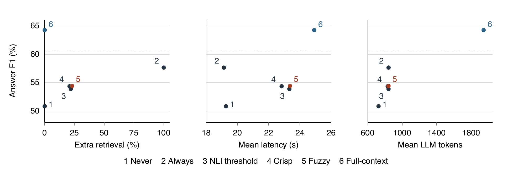

# V2 实验过程手册

A Fuzzy-NLI-based QA Chatbot System with Adaptive Retrieval

BNBU NLP 课程小组实验　｜　2026 年 11 月 16 日

本手册从项目问题开始，按原《实验方案 V2》第 0 至 15 节说明每节的输入、设计选择、操作、可核查产物和阶段结论。正式结论来自保留测试题，预实验结果用于作出是否继续的决定，校准结果用于选参数。三批题目互不重叠。

<strong>先认识 A 和 B&#32;</strong>同一道题先从自带候选池取两段作答，得到 A。再用规则改写查询、追加一段并重新作答，得到 B。实验为每一道题都保存两支输出，因此能知道门控跳过了多少原本可以改善的题。在线延迟另跑真实路径。

<strong>怎样读记录&#32;</strong>各页的时刻为北京时间。记录里早期的 Step 4 是完整 100 题预实验前的九项登记，早期 Step 5 是 DeepSeek 预实验，Step 6a 是 vLLM 接口诊断。原 V2 §10.1 的步骤 4、5、6 分别指校准、正式评估和统计报告。第 14 页有对应表。

章节导航

<table>
<thead>
<tr>
<th>
页
</th>
<th>
V2 内容
</th>
<th>
页
</th>
<th>
V2 内容
</th>
</tr>
</thead>
<tbody>
<tr>
<td>
<a href="#handbook_page_2">2–3</a>
</td>
<td>
§0 项目概况、§1 研究问题
</td>
<td>
<a href="#handbook_page_14">14–16</a>
</td>
<td>
§10 执行和可复现性
</td>
</tr>
<tr>
<td>
<a href="#handbook_page_4">4–5</a>
</td>
<td>
§2 数据、§3 组件
</td>
<td>
<a href="#handbook_page_17">17–18</a>
</td>
<td>
§11 实验结果表及图
</td>
</tr>
<tr>
<td>
<a href="#handbook_page_6">6–8</a>
</td>
<td>
§4 门控、§5 对照、§6 双分支
</td>
<td>
<a href="#handbook_page_19">19–20</a>
</td>
<td>
§12 统计区间与人工复核
</td>
</tr>
<tr>
<td>
<a href="#handbook_page_9">9–11</a>
</td>
<td>
§7 预实验与规模决定
</td>
<td>
<a href="#handbook_page_21">21–22</a>
</td>
<td>
§13 时间线、§14 风险与修复
</td>
</tr>
<tr>
<td>
<a href="#handbook_page_12">12–13</a>
</td>
<td>
§8 正式方案与消融、§9 指标
</td>
<td>
<a href="#handbook_page_23">23</a>
</td>
<td>
§15 C01–C19 核对与方案状态
</td>
</tr>
</tbody>
</table>

### 首先认识几个术语

<strong>BM25、NLI 和校准&#32;</strong>BM25 按查询词与段落内容的匹配程度排序。NLI 是自然语言推断，输出证据支持、矛盾或中立的分数。校准是在单独一批题上定门控参数，定稿后才用正式题评价。

### 用哪份材料核查

<strong>方案与实际执行&#32;</strong>《Experiment\_Protocol\_v2.docx》决定章节顺序。项目的 exp/EXPERIMENT\_LOG.md 追加保存逐日记录、当时的候选方案以及之后的更正。以日期对应的锁文件、缓存和汇总核查结果。手册中的教学例子均标明用途。

<strong>先看结果还是复现&#32;</strong>读结论可从第 17 页进入。查执行与数据来源可从第 14 页进入，离线回放命令见第 24 页。正文文件路径从项目根目录计算，Windows 与服务器目录另行说明。

配套成册文件位于 step6\_v2/。第 11 节结果册为 NLP\_V2\_Section11\_Results\_Booklet.docx，结论册为 NLP\_V2\_Experiment\_Conclusions.docx。

## 0&#32;&#32;项目概况

### 0.1 题目与课程要求

这是 BNBU NLP 小组学期论文的实验。论文题目为 A Fuzzy-NLI-based QA Chatbot System with Adaptive Retrieval。V2 列出 IEEE 10–12 页、10 pt、双栏、单倍行距，以及引言、综述、方法、实现与实验、结论五部分。课程提交的核验状态见 §13。

### 0.2 核心问题与 0.3 研究动机

<strong>准备与推理&#32;</strong>多跳问答经常要把两段信息连起来。现有证据可能不足，但对所有问题再检索可能改坏答对的题，也会改变用量。团队先问「B 究竟能救回多少题」，再问「能否只用第一轮可见信息选到这些题」。这样可区分检索方案本身的潜力与门控的选题能力。

### 0.4 系统流程与 0.5 门控信号

<strong>实际路径&#32;</strong>问题 → BM25 首轮两段 → 带段落引用的 A 答案 → 用 NLI 查证据支持程度，并检查段落之间是否出现桥接线索 → 选择 A，或按固定改写追加一段取得 B → 为最终答案选择引用句。Full-context 一次读入所有候选段落，对照更大的首次阅读预算。

<strong>决策理由&#32;</strong>首轮信号可以在 B 尚未产生时获得。NLI 表示证据与当前答案的关系，桥接代理表示段落间是否有可定位的词面联系。模型不确定性先查接口，最后暂缓纳入，避免混入尚未验证增量价值的信号。

### 0.6 成本口径与 0.7 预期贡献

<strong>风险与实际验证&#32;</strong>小候选池的额外排序开销有限，NLI 与第二次作答却会花时间。分别记录触发率、LLM 与 NLI 调用、token 以及端到端延迟。最终贡献是配对比较、量化 Oracle 余量，以及在共同输入和校准目标下检验两种决策形式。

### 0.8 现有原型

V2 记录了 mock LLM、mock NLI 和已具备的策略接口。准备阶段用合成响应检查格式和流程。实验记录以真实 DeepSeek、Qwen、DeBERTa 的运行归档为准。稠密检索在原型中未实现完整路径，所以首版采用已有 BM25。

V2 §0 原文。实验日志 11 月 14 日 21:40–21:57、11 月 15 日 16:26、20:16。

## 1&#32;&#32;研究问题与假设

<strong>准备&#32;</strong>将总问题拆成三个可检验的比较，并为它们找对应的参照。这样在最后解释结果时，每种差值都有清楚的比较对象。

研究问题与证据设计

<table>
<thead>
<tr>
<th>
问题
</th>
<th>
用什么比较
</th>
<th>
为什么这样做
</th>
</tr>
</thead>
<tbody>
<tr>
<td>
RQ1 选题与成本
</td>
<td>
Never、Always、Fuzzy、Full-context 和 A/B Oracle。记录正式 F1、触发率及真实路径成本
</td>
<td>
Never 给出首轮参照。Always 给出全追加读数。Oracle 给出两支中的潜力。Full-context 揭示小候选池的替代路径
</td>
</tr>
<tr>
<td>
RQ2 模糊推理的贡献
</td>
<td>
模糊门控对比同输入硬规则，再对比 NLI 单阈值
</td>
<td>
前一组控制输入和流程，后一组回答相对单信号整套策略的表现
</td>
</tr>
<tr>
<td>
RQ3 信号作用
</td>
<td>
固定完整 Fuzzy 的边界，分别移除 NLI 或桥接
</td>
<td>
观察原系统依赖哪种信息。把触发率变化与质量变化一并报告
</td>
</tr>
</tbody>
</table>

<strong>当时能判断什么&#32;</strong>最初 30 道题的 A/B 差与 pilot 的 Oracle 只能表明值得继续。正式前把五项 F1 对比和单项配对 95% 区间登记在 11 月 15 日 20:16。模板中 H1–H3 的原句和单独的显著性水平勾选缺少定稿记录。本手册据实引用已登记比较与区间，不回填假设。

<strong>阶段结论&#32;</strong>RQ1 的门控相对 Never 有收益，但各种成本的排序不同。RQ2 的同输入对照尚未确立模糊推理的独立优势。RQ3 的两项消融改变了实际触发率，观察对应各自的运行点。正式结果、效应量和范围分别见 §8、§11、§12。

V2 §1、§12。实验日志 11 月 15 日 16:26、20:16。step6\_v2/Experiment\_Report.md。

## 2&#32;&#32;数据集

### 2.1 候选数据与来源

<strong>准备与选择&#32;</strong>使用 Hugging Face 的 hotpotqa/hotpot\_qa，配置 distractor，公开 validation 划分。官方 test 的答案不公开，公开 validation 可以在自己保留的子集上按官方规则评分。也考虑过官网下载 JSON，以及 BEIR、KILT、FlashRAG 等版本。前者保留题目格式。选 HF 便于加载和统一划分。其他候选缺少本设计依赖的每题原始 distractor 段落池。

### 2.2 题型、划分与样本量

<strong>执行&#32;</strong>公开 validation 共有 7,405 道题，过滤 type=bridge 后有 5,918 道。用随机种子 42 打乱后顺序取样。保留原始 \_id，核验三份清单共 1,600 个互异 ID。桥接题符合跨段证据研究问题，comparison 题在三份清单均排除。正式保留集规模在 §7.4 另行确认。

三份固定清单各自做什么

<table>
<thead>
<tr>
<th>
文件
</th>
<th>
题数
</th>
<th>
用途
</th>
</tr>
</thead>
<tbody>
<tr>
<td>
pilot.json
</td>
<td>
100
</td>
<td>
做模型和检索验证、A/B 预实验、信号诊断。最初 30 题是其子集
</td>
</tr>
<tr>
<td>
tune.json
</td>
<td>
500
</td>
<td>
校准候选门控并锁参数。Step 6a 的接口检查只用前 30 道 A
</td>
</tr>
<tr>
<td>
test.json
</td>
<td>
1,000
</td>
<td>
锁定之后做正式质量评分。计时另以固定哈希取其中 32 道共用题
</td>
</tr>
</tbody>
</table>

### 2.3 预处理与引用对齐

<strong>操作&#32;</strong>保存官方题干、答案、context 段落及原句顺序和 supporting\_facts。金标句以「原段落标题、从 0 开始的句号索引」配对。检索对标题和正文另做分词，评测时沿用原文位置。正式集 998 题有十段，各有一题为四段、两段。两段题用完首轮后无新段落可加，仍保留原题和分支定义。

<strong>验收&#32;</strong>对照清单与哈希，检查三份 ID 互斥、所有题型为 bridge、正式金标索引能回到原句。Windows 的正式 manifest 经用户提供后，在 Mac 和 GPU 上核对为同一文件。原始 dump 日期在模板中无独立确认，数据身份依据来源、清单和哈希。

pilot 副本 NLP\_Experiment\_Materials\_2026-11-15/exp/step1/pilot.json。根目录 tune.json、test.json。实验日志 11 月 14 日 21:30、11 月 15 日 20:16。

## 3&#32;&#32;系统组件

### 3.1 检索器

<strong>准备&#32;</strong>用 rank\_bm25 的 BM25Okapi 在每题自己的候选池内排序。输入是规范分词后的标题、正文和查询，使用库的默认 BM25 参数。A 的查询是题干。B 的查询拼接题干、A 排名第一段的标题和首句，并仅在未取段落中排序。

<strong>证据与取舍&#32;</strong>在 100 道 pilot 题上比较首轮取 2、3、4 段和追加数。首轮 2 段双金标覆盖 31%，再取 1 段为 59%。相同三段预算的一轮 top-3 为 45%。选择 k=2、m=1 是因为这个预算下规则改写取得了更高覆盖。再加更多段会改变与 Full-context 的预算差。采用规则改写也省去单独的 LLM 查询生成调用。覆盖结果评价检索，作答收益在 §7 核实。

### 3.2 作答模型

<strong>先验证再部署&#32;</strong>最初对预实验前 30 题用 DeepSeek 验证 A/B，F1 为 .565/.733。随后补到 100 题，正式及校准采用 GPU 上的 Qwen2.5-7B-Instruct 和 vLLM。早期还考虑 GPT-4o-mini，未形成同批实测对照。正式 A、B 和 Full-context 使用同一模型、同一答题提示、温度 0、最大输出 128。Full-context 按原顺序放全部候选。

<strong>数据流&#32;</strong>模型给出 answer 和 citations。答案和有效段落引用先落盘。正式时用相同的 Qwen 选择器，在有效引用段落的编号句子中为既定答案选证据，映射回原句索引。正式 A/B/Full 回答解析回退都是 0。选句异常另计，见 §8–9。

### 3.3 NLI 核验器与跨段落证据构造

<strong>决定&#32;</strong>使用 MoritzLaurer/DeBERTa-v3-large-mnli-fever-anli-ling-wanli。按有效引用顺序拼接段落。无有效引用时回退到检索段落并记录。前提与下句组成 NLI 输入，最多 512 token。

~~~
The answer to the question "{question}" is: {answer}.
~~~

<strong>理由&#32;</strong>单句最高分可能只覆盖一跳。单句最低分可能把需要两段合起来才成立的答案判为缺证据。拼接便于让模型同时看到两段，但仍需抽查缺跳、错引和两段共同支持。正式离线 CUDA batch 4，计时 CPU 四线程。A/B 的正式截断各 3，人工与探索性检查见 §7、§12。

compare\_models.py、bm25\_topk.py、run\_pilot.py、generate\_test\_v2.py。实验日志 11 月 14 日 21:41–22:07、11 月 15 日 09:40、20:16。

## 4&#32;&#32;模糊门控设计

### 4.1 输入变量

<strong>准备与选择&#32;</strong>只使用 A 可见的两个输入。NLI 风险 r = 1 − entailment，证据支持度越低，风险越高。桥接代理在两首轮段落之间双向查找另一段完整标题，经 NFKC、大小写折叠及连续完整词序列匹配，在单句内比较。找到记桥接存在，未找到记缺失风险。段落不可用则回退为 NLI 单信号。

<strong>为什么&#32;</strong>整标题比部分词或别名更容易追溯到原句，代价是容易漏掉简称、别名和代词。实体链接能覆盖部分变体，但会引入独立模型和误差。首版用 entailment 和桥接，neutral、contradiction 保存作诊断。Qwen 的 logprob 检查可见 §7.3，正式门控锁定这两项输入。

### 4.2 隶属函数、规则与决策

<strong>规则&#32;</strong>用零阶 Sugeno。把 r 从低锚点 lo 到高锚点 hi 线性映射为高风险隶属度 h，超出两端截为 0 或 1。低风险隶属度为 1−h。桥接存在时四规则中的低、高风险后件为 0 和 1−w。桥接未找到时为 w 和 1。乘积激活、加权平均后，分数为 (1−w)×h + w×桥接缺失指示。桥接不可计算时用 h。

<strong>对照与校准&#32;</strong>硬规则共用上述输入与后件形式，把 h 换成对锚点中点的二值判断。两者分别从同一组 dev 风险分位数组合和权重候选中选参。lo 分位 .10/.25/.40，hi 为 .55/.70/.85，w 为 .125/.25/.375。跳过重合锚点。三门控各选 100/500 道 dev 题。20% 是主观、预先确定的共同预算。允许保留足够正例选择机会，又限制额外检索。

<strong>怎样锁定&#32;</strong>取配对 F1 总增益最高的候选，同分先比更少变差，再比更多改善，最后按固定网格顺序。按分数降序、NLI 风险降序、SHA-256(42:\_id) 和 ID 升序排列。把第 100 名的四元组锁作边界。正式集逐题比较该边界，实际率可以偏离 20%。

正式前锁定参数&#32;&#32;数字为便于阅读的舍入值

<table>
<thead>
<tr>
<th>
门控
</th>
<th>
lo
</th>
<th>
hi
</th>
<th>
w
</th>
</tr>
</thead>
<tbody>
<tr>
<td>
<strong>Fuzzy</strong>
</td>
<td>
0.00058925
</td>
<td>
0.38152673
</td>
<td>
0.375
</td>
</tr>
<tr>
<td>
同输入硬规则
</td>
<td>
0.00058925
</td>
<td>
0.00750083
</td>
<td>
0.125
</td>
</tr>
</tbody>
</table>

<strong>教学示意&#32;</strong>若某题的 h 为 .5，代入锁定的 w=.375，找到桥接时分数为 .3125，未找到时为 .6875。这两个数只演示规则如何组合信号。

<strong>阶段读出&#32;</strong>dev 同预算下，Fuzzy、硬规则和 NLI 阈值的 F1 分别是 53.62%、53.52%、53.21%。这是用于选参的拟合成绩。精确边界、tie 规则和脚本身份保存在 locked\_gates.json。

实验日志 11 月 15 日 15:23、16:26、17:15。calibrate\_gates\_v2.py。step4\_dev/gates/locked\_gates.json。

## 5&#32;&#32;对比策略

### 主策略及参照

<strong>准备&#32;</strong>六种策略有各自的比较任务。除 Full-context，质量可从同一对 A/B 缓存中取值，正式问答、检索与解码的差异因此可追溯到选支或上下文预算。

主策略怎样作答以及为什么保留

<table>
<thead>
<tr>
<th>
策略
</th>
<th>
在一题上怎么做
</th>
<th>
对照目的
</th>
</tr>
</thead>
<tbody>
<tr>
<td>
Never
</td>
<td>
取 A
</td>
<td>
首轮质量与成本参照
</td>
</tr>
<tr>
<td>
Always
</td>
<td>
取 B
</td>
<td>
量化固定追加的质量与成本
</td>
</tr>
<tr>
<td>
NLI 阈值
</td>
<td>
只依首轮 NLI 风险作硬切分
</td>
<td>
衡量单信号门控
</td>
</tr>
<tr>
<td>
同输入硬规则
</td>
<td>
NLI 加桥接，NLI 隶属度二值化
</td>
<td>
在相同信号集合下比较决策形式
</td>
</tr>
<tr>
<td>
<strong>Fuzzy</strong>
</td>
<td>
NLI 加桥接，用连续隶属度
</td>
<td>
考察模糊选题和质量预算取舍
</td>
</tr>
<tr>
<td>
Full-context
</td>
<td>
依原顺序读入整个候选池，一次生成答案
</td>
<td>
衡量短候选池下完整证据预算
</td>
</tr>
<tr>
<td>
A/B Oracle
</td>
<td>
以金标答案 F1 事后取优，持平取 A
</td>
<td>
量化 A/B 上界。实测成本只列可部署路径
</td>
</tr>
</tbody>
</table>

### 5.2 同输入对齐与 5.3 真实路径

<strong>控制项&#32;</strong>两种双信号门控共享输入、A/B、改写、模型与解码，并在 dev 各选 100 题。分别选参后锁边界。test 实际率在结果表明列。

<strong>为什么单测耗时&#32;</strong>离线缓存已经有答案，直接取出无法包含模型调用与 NLI 的耗时。真实路径中 Always 可直接构造 B，因为其查询改写仅用题干和首段，不必先生成 A。Fuzzy、Crisp、NLI 阈值先生成 A、核验，再决定是否生成 B，最后选择证据句。Full-context 完成一次问答和证据选择。Oracle 只进质量表。

<strong>阶段结果&#32;</strong>六种策略均进入正式评估。Full-context 的测试 F1 最高，计算代价见 §11。

V2 §5。实验日志 11 月 15 日 16:26、20:16、11 月 16 日 08:08。

## 6&#32;&#32;配对双分支设计

### 6.1 给同一道题保存 A 和 B

<strong>当时的问题&#32;</strong>若只在门控触发后生成 B，未触发的题缺另一支，无法知道门控漏掉了几道本来能改善的题。为每题缓存 A、B 会增加一次性评估成本，但可算漏选、Oracle 和配对差，也能让策略共用同一次生成。

<strong>执行&#32;</strong>生成 A/B 后以相同题目 ID 对齐两支答案、引用、官方分数和 NLI。正式阶段同题另存 Full-context。每个策略对同一题选 A 或 B，合并该支答案与句级引用，一起交给官方评分器。

### 6.2 三类标签与 Oracle

逐题标签定义

<table>
<thead>
<tr>
<th>
标签
</th>
<th>
ΔF1 = F1(B) − F1(A)
</th>
<th>
对门控意味着什么
</th>
</tr>
</thead>
<tbody>
<tr>
<td>
improved
</td>
<td>
严格大于 0
</td>
<td>
正类，触发可获得答案质量收益
</td>
</tr>
<tr>
<td>
tie
</td>
<td>
等于 0
</td>
<td>
官方 F1 持平，容差取 0
</td>
</tr>
<tr>
<td>
degraded
</td>
<td>
严格小于 0
</td>
<td>
触发会降低这道题的官方 F1
</td>
</tr>
</tbody>
</table>

<strong>决策理由&#32;</strong>答案 F1 捕捉部分改进，使用 EM 翻转会漏掉这类题。以「新增金标段落」定义正类会把检索命中误当作答案改善。ε=0 保留所有官方分差，所以措辞变化也可能改变标签。Oracle 按题挑较高 F1，持平保留 A，避免把没有 F1 收益的触发计入上界路线。

### 6.3 教学例子与 6.4 延迟分测

<strong>仅为示意&#32;</strong>假设甲题 A=0、B=1，乙题 A=1、B=0，Always 和 Never 的均值同为 .5。Oracle 用甲的 B 和乙的 A，均值为 1。只看平均值会看不见这两次方向相反的变化。真实题数见 §11.2。

<strong>验收&#32;</strong>正式集 A/B 各 1,000 条，每题还保存一条 Full-context。A/B 共 2,000 个 NLI 结果。离线质量、触发率与真实成本用不同记录，后者须通过 §9、§10 的实测。

实验日志 11 月 15 日 09:40、20:16、11 月 16 日 08:08。step5\_v2/per\_question.csv。

## 7&#32;&#32;预实验与进入正式方案的判断

### 7.1 最小设置与运行过程

<strong>准备&#32;</strong>pilot 100 道 bridge 题、两轮 BM25、DeepSeek API 与 YangQS 上的 RTX 4060。11 月 14 日先跑前 30 题确认真实 API 能回传结构化答案、检索流程一致、分支可评分。11 月 15 日正式补全 100 题前，登记标签、Oracle、四项通过条件、NLI 构造、必要时一次返工上限和人工审核范围。

<strong>执行&#32;</strong>复用前 30 题的已成功 A/B 答案，补齐 100 对缓存，再用本地 DeBERTa 评分 200 支。预实验原输出是段落级引用，选择「两段金标均被检索到的比例」登记覆盖读数。Windows 使用 README\_step5.md 的两阶段命令。API key 通过环境变量提供。

### 7.2 三项读出

正式预实验的实测结果

<table>
<thead>
<tr>
<th>
读出
</th>
<th>
结果
</th>
</tr>
</thead>
<tbody>
<tr>
<td>
双金标段落覆盖
</td>
<td>
A 31/100，B 59/100
</td>
</tr>
<tr>
<td>
A 到 B 的答案质量
</td>
<td>
EM .520 → .650，F1 .628 → .752。改善 16、持平 82、变差 2
</td>
</tr>
<tr>
<td>
A/B Oracle 的质量余量
</td>
<td>
Oracle F1 .765。相对 A +.137，配对 95% CI [.077, .203]
</td>
</tr>
</tbody>
</table>

NLI 200 支均完成，截断 0。A/B 平均 entailment .876/.923。两个均值只能描述该批两支的支持分数。选题能力另作诊断。

### 7.3 原始 GO 判定

结果可见前登记的主观门槛与实测对照

<table>
<thead>
<tr>
<th>
条件
</th>
<th>
预注册界线
</th>
<th>
实际与判定
</th>
</tr>
</thead>
<tbody>
<tr>
<td>
Oracle 相对 A 点估计
</td>
<td>
至少 +.05 F1
</td>
<td>
+.137，通过
</td>
</tr>
<tr>
<td>
Oracle 增益 95% 区间下界
</td>
<td>
严格大于 0
</td>
<td>
+.077，通过
</td>
</tr>
<tr>
<td>
改善比例
</td>
<td>
至少 10%
</td>
<td>
16%，通过
</td>
</tr>
<tr>
<td>
变差题数除以改善题数
</td>
<td>
至多 0.5
</td>
<td>
2/16＝0.125，通过
</td>
</tr>
</tbody>
</table>

<strong>为什么组合四项&#32;</strong>点估计保留值得研究的量级，区间下界检查是否与零增益区分。改善比例为后续门控留下可识别的正例，变差比避免在频繁改坏的追加路径上投入调参。只用点估计会遗漏不确定度，只用区间下界又可能接受很小的增益。

<strong>阶段结论&#32;</strong>四项通过，GO。按登记方案，只有未通过时才允许一次改写更新后同标准复测，本次未触发。人工审核的「不可接受比例」未记录定量预注册值，保留为定性检查。

实验日志 11 月 15 日 09:40、09:50、10:33。README\_step5.md。根目录 per\_question.csv、branches.jsonl。

## 7.3&#32;&#32;追加信号与接口检查

### 先查 NLI 和历史 API

<strong>准备与读出&#32;</strong>单用首轮低 entailment 区分改善与持平，AUC 为 .699，95% 区间 \[.579, .812\]。YangQS 人工抽查 20 条分支记录，涉及 15 道题。标记为 NLI 判断正确 11、词面重合误判 6、多跳误判 2、其他误判 1、hypothesis 误判 0。抽样用于定位机制，比例不外推到全体。

<strong>更正历史记录&#32;</strong>初次探测把 −9999 占位算作“非零”，一度认为候选分数可用。后来按事先登记的答案 span 方案重跑 200 次，88 道 A/B 均未改变的主分析子集上 margin AUC=.500，绝大多数候选为占位。12:08 条目更正了 11:48 的解释。改到温度 1 会改变已锁定的比较。因此保留原 pilot，改查本地服务是否能给有变化的数。

### Step 6a 本地 vLLM 非退化验证

<strong>准备与执行&#32;</strong>Mac 通过授权 SSH 操作租用 Tesla T4。在独立环境部署 vLLM 0.8.5、原始 Qwen FP16，核验权重分片和依赖，服务绑定 127.0.0.1。用 tune 前 30 题，仅跑 A，温度 0，top\_logprobs=5。在看到结果前登记四项阈值。

Step 6a 阈值与真实接口读数

<table>
<thead>
<tr>
<th>
检查
</th>
<th>
事前要求
</th>
<th>
实测
</th>
</tr>
</thead>
<tbody>
<tr>
<td>
答案片段选中 token 的零分数
</td>
<td>
≤50%
</td>
<td>
28/127＝22.05%
</td>
</tr>
<tr>
<td>
候选中 logprob ≤−9000
</td>
<td>
&lt;5%
</td>
<td>
0/2595
</td>
</tr>
<tr>
<td>
每题平均选中 logprob
</td>
<td>
≥10 个不同值且方差 &gt;0
</td>
<td>
30 个，方差 .02372766
</td>
</tr>
<tr>
<td>
每题平均候选 margin
</td>
<td>
≥10 个不同值且方差 &gt;0
</td>
<td>
30 个，方差 15.39186443
</td>
</tr>
</tbody>
</table>

<strong>阶段结论&#32;</strong>四项 PASS，零判定按保存的六位小数。这个检查确认接口分数有变化。既没有计算 AUC，也没有据此把不确定性纳入正式门控。

### 按 V2 补做 NLI 与桥接同预算比较

<strong>决定时点与理由&#32;</strong>初始 pilot 已知汇总后，11 月 15 日 15:23 才批准追加比较。两组各取 20/100 题。用单独 NLI 作主要对照以观察新增桥接的作用，同时列随机期望。将 NLI 风险与桥接缺失风险转换为带并列的百分位再等权合成，避免原始尺度主导，也避免在同一批题上追结果调权。20 题覆盖 16 个已知改善题所需预算，并留四个选择名额。

<strong>执行与结果&#32;</strong>从 A 构造排名，固定哈希处理并列，再回读已有 ΔF1 标签。NLI 单独与 NLI+桥接均选中 6 个改善、14 个持平、0 个变差，重合 19 题。随机选择的理论期望为 3.2、16.4、0.4。该代理与预算下桥接没有额外增加命中。这个定性背景不改变原 GO，也不足以判断正式 Fuzzy 的表现。

实验日志 11 月 15 日 10:48–15:30。README\_step6a.md。step6a\_check/logprob\_check.json。pilot\_signals\_v2/summary.json。

## 7.4&#32;&#32;正式样本量如何确定

<strong>准备&#32;</strong>先取已完成 pilot 的逐题 F1 差异和 16% 改善比例，再把 500 题与已预留的 1,000 题作为两种方案比较。两种选择都从固定数据来源和保留划分出发，问题在于精度与算力的取舍。

预实验后的规模比较&#32;&#32;计划量

<table>
<thead>
<tr>
<th>
尺度
</th>
<th>
500 道正式题
</th>
<th>
1,000 道正式题
</th>
</tr>
</thead>
<tbody>
<tr>
<td>
改善比例若仍为 16% 的题数参考
</td>
<td>
约 80
</td>
<td>
约 160
</td>
</tr>
<tr>
<td>
A/B Oracle − A 的均值差参考半宽
</td>
<td>
约 .02877 F1
</td>
<td>
约 .02034 F1
</td>
</tr>
<tr>
<td>
正式 A/B/Full 计划问答数
</td>
<td>
1,500
</td>
<td>
3,000
</td>
</tr>
<tr>
<td>
连同固定 dev 的串行问答时间参考
</td>
<td>
约 5.31 小时
</td>
<td>
约 8.50 小时
</td>
</tr>
</tbody>
</table>

<strong>这些数怎样估&#32;</strong>用 pilot Oracle−A 的样本标准差 .328185 作精度参考，均值差半宽近似为 1.96×标准差/√n。1,000 题的参考半宽约窄 29%。时间参考使用 Step 6a 的 30 个 A 请求平均约 7.65 秒，按所有请求串行且等长估算。选择器、NLI、计时测量和恢复另计。字面上的 8.50 小时是资源场景估算，实际正式作业的时间见 §13。

<strong>决策与备选影响&#32;</strong>500 题可把正式作答数减半，但可改善正例预期更少、区间参考更宽。用户 11 月 15 日确认本轮 GPU 时间没有固定上限，于 16:21 采用 1,000 题。这个推算沿用 DeepSeek 预实验方差，不能当作 Qwen 正式效应或 Fuzzy 对 Crisp 的功效估计。

<strong>交接与验收&#32;</strong>方案决定后才进入 dev 校准。用户后来提供 test.json，20:16 核验正式清单哈希、1,000 个独立 ID、三批互斥性，之后才启动正式作业。早期只在 Windows 验证的状态与之后三端校验分开记录。

实验日志 11 月 15 日 16:10–16:21、20:16。step6a\_check/logprob\_check.json。

## 8&#32;&#32;主实验安排与消融

### 8.1 正式运行前锁定什么

<strong>输入与准备&#32;</strong>用已核验的 test.json、dev 门控锁文件、模型权重、提示词和改写脚本、固定版本官方评分器。tokenizer 预检确认全部 A/B/Full 提示与 128 个输出预留量可放进 4,096 token。

<strong>证据选择的理由&#32;</strong>将既有作答模型的段落引用交给同一个 Qwen 选择器，从原句中选证据，再还原标题与零起始句号。如果选句提示超出 3,968 token，按固定顺序等分候选并合并有效选择。正式运行没有触发这一分段。直接让问答提示输出句号会改变已锁定的 A/B 生成。把整段每句都当引用则会大量增加不精确预测。分阶段做可以保留 dev 已锁定的问答提示，并测量真实选句成本。

<strong>预检和执行&#32;</strong>在 dev 取 24 题的 A/B，加 8 题 Full-context，合计 56 个分支。要求完整、结构可解析且至少有非空句级预测。56 支通过，53 支有证据。正式生成后先做 A/B NLI，再离线回放策略。Full-context 有独立输出，未纳入 A/B Oracle 搜索。真实路径计时用同一 32 道正式题。

### 8.2 两项优先消融

改动与固定因素

<table>
<thead>
<tr>
<th>
设定
</th>
<th>
改动
</th>
<th>
为什么这样操作
</th>
</tr>
</thead>
<tbody>
<tr>
<td>
Fuzzy 去掉 NLI
</td>
<td>
把每题 NLI 风险固定为两个锁定锚点的中点。高风险隶属度 .5，排序次键也固定
</td>
<td>
保留中性输入。设为 0 或 1 会把所有题统一推向低或高风险
</td>
</tr>
<tr>
<td>
Fuzzy 去掉桥接
</td>
<td>
启用原缺桥接回退，只用首轮 NLI 隶属度评分
</td>
<td>
沿用原门控已有的缺信号语义
</td>
</tr>
</tbody>
</table>

<strong>控制项&#32;</strong>两项都复用同一批正式 A/B、原规则和决策边界。消融后按原边界逐题选支。另行校准到相同目标预算会变成另一种比较。模型不确定性未进入完整策略，因此此处只做 V2 的两项优先消融。

<strong>结果与阶段结论&#32;</strong>完整 Fuzzy 的触发率/F1 为 23.0%/54.42%。去掉 NLI 为 66.0%/56.82%，去掉桥接为 20.7%/53.79%。前者召回更多改善题且触发范围扩大，后者少选并漏掉更多可改善题。这里评估原固定决策边界对信号移除的响应。等预算贡献仍缺对照。

实验日志 11 月 15 日 20:16、20:20、11 月 16 日 08:08。generate\_test\_v2.py、evaluate\_test\_v2.py。

## 9&#32;&#32;评价指标

### 9.1 首要指标

<strong>为什么要三组数据&#32;</strong>答案 F1 衡量最终作答，触发率衡量追加路径的使用次数，token 与延迟衡量运行负担。Full-context 的第二轮率为零，但它首轮读取整个候选池。Always 的正式率是 100% 路径选择。原清单中一个两段题无可新增段落，仍计为选 B。

### 9.2 次要指标与诊断

指标的分母与用途

<table>
<thead>
<tr>
<th>
指标
</th>
<th>
怎么算
</th>
<th>
该怎样读
</th>
</tr>
</thead>
<tbody>
<tr>
<td>
答案 F1 与 EM
</td>
<td>
逐题使用固定官方 HotpotQA 评分器，最后跨 1,000 题取均值
</td>
<td>
F1 允许部分词重合，EM 要求规范化后完全一致
</td>
</tr>
<tr>
<td>
Supp-F1
</td>
<td>
以原标题与句号索引组成的集合，对照预测句级支持事实
</td>
<td>
最终证据命中。NLI 整段分数另存
</td>
</tr>
<tr>
<td>
选题 P/R/F1
</td>
<td>
正类为 B&gt; A。P 以触发为分母，R 以可改善题为分母，F1 为调和平均
</td>
<td>
Fuzzy 的 P 是 56/230，R 是 56/123
</td>
</tr>
<tr>
<td>
逐题改善/持平/变差
</td>
<td>
相对同题 Never 的答案 F1 计算
</td>
<td>
策略全体取 1,000 为分母。触发子集另计
</td>
</tr>
<tr>
<td>
配对 95% 区间与 Oracle
</td>
<td>
同题算 F1 差。Oracle 按逐题 F1 取优
</td>
<td>
前者量化不确定度，后者量化 A/B 质量余量
</td>
</tr>
</tbody>
</table>

### 9.3 计算与成本采集细节

<strong>评分和选择器&#32;</strong>评测脚本固定在 commit fa3a36370899e1d85822de61e58c85ea19993154。官方答案归一化包括小写、标点、冠词和空白。句级选择器剔除无效 ID 并去重，解析异常或无有效段落引用时记空证据。正式 A/B/Full 的选择器解析异常分别 11/10/8，空句预测分别 92/58/35。作答解析失败为 0/0/0。

<strong>计时口径&#32;</strong>每种策略先用 8 道 dev 题预热，计时并发 8。从检索或上下文准备开始，至最终选句完成。设备模型已加载。记录均值和 P50/P90/P95、问答与选句的 LLM 输入/输出 token、NLI 调用与输入 token。正式质量用 CUDA NLI 回放结果。计时经 dev 验证使用四 CPU 线程的 NLI。

<strong>交接&#32;</strong>相同 32 个哈希选出的 ID 对六条可部署路径各测一次，归档共 192 条。配对 F1 区间来自全部 1,000 题，成本读数按该配置描述。

实验日志 11 月 15 日 20:16、11 月 16 日 08:08。step5\_v2/hotpot\_evaluate\_v1.py、latency\_test\_v2.jsonl。

## 10&#32;&#32;实验流程与可复现性

### 10.1 六个步骤如何衔接

V2 步骤与对应的原始记录

<table>
<thead>
<tr>
<th>
V2 步骤
</th>
<th>
工作内容
</th>
<th>
完成后用于交接的产物
</th>
</tr>
</thead>
<tbody>
<tr>
<td>
1
</td>
<td>
备齐 pilot、选 BM25 和模型、先做真实运行验证
</td>
<td>
三份分割清单。早期 Step 1–3。k=2、m=1
</td>
</tr>
<tr>
<td>
2
</td>
<td>
100 题 A/B、官方答题评分、NLI 与审核
</td>
<td>
早期 Step 5。pilot 缓存、覆盖、分类、人工审核
</td>
</tr>
<tr>
<td>
3
</td>
<td>
原 GO、后续信号比较、锁正式规模
</td>
<td>
§7.3 与 §7.4。接受 1,000 题正式集
</td>
</tr>
<tr>
<td>
4
</td>
<td>
在 tune 产生 500 对 A/B，校准并锁三个门控
</td>
<td>
step4_dev/gates/locked_gates.json 及 dev 数值
</td>
</tr>
<tr>
<td>
5
</td>
<td>
独立测试。生成 A/B/Full、离线评分消融和真实计时
</td>
<td>
step5_v2/。质量、成本、预测和校验清单
</td>
</tr>
<tr>
<td>
6
</td>
<td>
填表、统计配对区间、错误分析、撰写章节
</td>
<td>
step6_v2/。结果与结论、§12 审读、英文稿
</td>
</tr>
</tbody>
</table>

早期 Step 4 是 100 题前的阈值登记，早期 Step 5b 是 DeepSeek logprob 复查，Step 6a 是 Qwen 接口检查。这些旧名继续用于目录定位。原 V2 §10.1 列到步骤 6，后续是归档与论文合稿。

### 步骤 4 从串行生成到锁参

<strong>准备&#32;</strong>校验 tune 哈希、模型端点与提示长度。起初沿 Step 6a 的单序列服务串行处理。在未看 dev 成绩时，观察吞吐并评估服务器剩余时间。项目决定把最大并发序列调到 8，继续使用相同权重、精度、prompt 和解码。

<strong>过程与理由&#32;</strong>八个 ID 分片各自落盘，按 tune 原顺序合并。考虑调度可能改变数值舍入，保留 127 条旧串行记录，批量版从头生成全 1,000 条，避免混源。离线 NLI 时临时暂停 Qwen 给 DeBERTa 让出 GPU，完成后恢复同一服务脚本。

<strong>验收结果&#32;</strong>16:43:36 开始、17:10:12 完成批量作答，17:10:53 产生门控锁。验证 500 个 ID、1,000 支答案及 NLI 评分、三组 dev 选择均为 100。锁写入模型版本、生成参数、输入和源码哈希、精确边界。dev 数据出现一题无法追加剩余段落，按原方案保留。

实验日志 11 月 15 日 16:23–17:15。README\_step4\_v2.md。step4\_dev/gates/dev\_summary.json。

## 10.1&#32;&#32;正式生成、恢复与分析

### 步骤 5 先做运行预检

<strong>准备&#32;</strong>Mac 核对数据与锁文件后传到 GPU 的 \~/nlp。按 README\_step5\_v2.md 放置正式入口、原脚本、模型和打分器。先核对服务端清单，再把作业放到 tmux。SSH 用于管理和传输，vLLM 服务限本机 loopback。

<strong>执行&#32;</strong>预检选句通过，Qwen 和 CUDA NLI 同时驻留 T4 因显存不足失败，预登记的 CPU NLI 回退通过。于是正式离线 NLI 仍在 CUDA 批处理，实时计时采用 Qwen GPU 加 CPU NLI。见 §8、§9。

~~~
cd ~/nlp
sha256sum -c step5_v2/inputs.sha256
tmux new-session -d -s nlp-v2-test 'cd "$HOME/nlp" && bash run_step5_v2.sh >> step5_v2/run.log 2>&1'
~~~

### 作业中断怎样判定与恢复

关键异常、证据和恢复

<table>
<thead>
<tr>
<th>
异常
</th>
<th>
如何查明
</th>
<th>
采取的修复与确认
</th>
</tr>
</thead>
<tbody>
<tr>
<td>
SSH 观察断开
</td>
<td>
最后看见 2,004/3,000 对缓存记录。重连后看到生成完成及原文件哈希
</td>
<td>
脱离 SSH 的 tmux 保持运行。依据远端记录继续，生成齐全
</td>
</tr>
<tr>
<td>
切换 CUDA NLI 的脚本退出
</td>
<td>
tmux 会话标识传给 send-keys 时未解析为窗格
</td>
<td>
明确取窗格 ID。从 3,000 条原记录恢复，未重新生成
</td>
</tr>
<tr>
<td>
NLI 评分回放读不到正确键
</td>
<td>
NLI 的 model 字段覆盖了答题模型身份，数值已计算
</td>
<td>
保留原文件，迁移身份字段。反向恢复元数据后逐条相等，确认 2,000 条分数不变
</td>
</tr>
</tbody>
</table>

<strong>验收&#32;</strong>11 月 16 日 08:07:31 远端退出码 0，正式归档完成。核验三类缓存与九套官方预测，重新计算逐题分数和实测均值。正式结果只用原生成批次。

### 步骤 6 从正式归档生成分析

先验证 step5\_v2/archive.sha256，再运行 analyze\_step6\_v2.py。由同一逐题表生成五项配对估计、探索性样本与质量成本图。接着填写第 11 节，按第 12 节说明不确定度和错误机制，并生成 IEEE 双栏方法与实验章节预览。

实验日志 11 月 15 日 20:16–22:22、11 月 16 日 07:50–08:24。README\_step5\_v2.md。README\_step6\_v2.md。

## 10.2&#32;&#32;可复现性清单与回放

七项身份和恢复约定

<table>
<thead>
<tr>
<th>
项目
</th>
<th>
已核实的口径
</th>
</tr>
</thead>
<tbody>
<tr>
<td>
种子
</td>
<td>
划分、哈希规则与 bootstrap 用 42。温度 0。原正式请求和服务未显式传解码 seed
</td>
</tr>
<tr>
<td>
正式重复
</td>
<td>
每题 A/B/Full 各一次生成。九种质量结果从缓存回放。成本每法在共用 32 道题各一次
</td>
</tr>
<tr>
<td>
硬件与软件
</td>
<td>
原运行 T4、vLLM 0.8.5、Python 3.10.12、PyTorch 2.6.0+cu124、Transformers 4.51.3。详细环境在 §10.2 清单
</td>
</tr>
<tr>
<td>
代码版本
</td>
<td>
归档脚本、门控锁与 SHA-256 固定正式身份。正式运行没有对应的归档 Git commit
</td>
</tr>
<tr>
<td>
双分支与日志
</td>
<td>
正式 answers 3,000、evidence 3,000、NLI 2,000、逐题表 1,000、实测日志 192。目录为 step5_v2
</td>
</tr>
<tr>
<td>
缓存策略
</td>
<td>
答案、证据和 NLI 以答题模型、ID、分支配对，NLI 身份单列。改数据、模型、提示或检索时从受影响阶段启用新缓存
</td>
</tr>
<tr>
<td>
失败重试
</td>
<td>
应用层最多三次尝试并退避，超时 120 秒。逐条追加保留已成功记录。恢复时检查未知键、重复与未完整末行
</td>
</tr>
</tbody>
</table>

### 新成员如何回放

<strong>先核验身份&#32;</strong>在 Mac 的项目根目录检查下面的清单。接着在临时目录按《Reproducibility\_Checklist.md》的完整命令依序重跑 dev 校准、正式质量回放和步骤 6。回放只需要已有缓存和 README 列出的 Python 依赖。

~~~
shasum -a 256 -c step6_v2/reproducibility.sha256
(cd step4_dev && shasum -a 256 -c results.sha256)
shasum -a 256 -c step5_v2/archive.sha256
~~~

<strong>应看到什么&#32;</strong>23 项本地、12 项 dev、27 项正式身份验证通过。三个 dev 产物、九个正式预测、逐题表、质量汇总和四个步骤 6 产物逐字节一致。192 条计时记录重新聚合后与归档一致。归档验证覆盖已保存输出的重放。权重重新推理和重新计时属于其他验证范围。

step6\_v2/Reproducibility\_Checklist.md 含完整可执行命令与预期结果。实验日志 11 月 16 日 09:19。

## 11&#32;&#32;结果记录与逐题读数

### 11.1 主结果

<strong>准备与理由&#32;</strong>按原 V2 表格，质量、正式触发率用 1,000 题，平均时延用共用的 32 题。校准目标对三个门控都是 20.0%。Oracle 写质量和离线选 B 比例。完整 P50/P90/P95、LLM 输入/输出及 NLI 用量另在配套结果册。

正式答案质量及实测平均成本

<table>
<thead>
<tr>
<th>
策略
</th>
<th>
答案 F1
</th>
<th>
EM
</th>
<th>
Supp-F1
</th>
<th>
正式触发率
</th>
<th>
时延均值 秒
</th>
</tr>
</thead>
<tbody>
<tr>
<td>
Never
</td>
<td>
50.85%
</td>
<td>
40.10%
</td>
<td>
47.51%
</td>
<td>
0.0%
</td>
<td>
19.26
</td>
</tr>
<tr>
<td>
Always
</td>
<td>
57.66%
</td>
<td>
46.20%
</td>
<td>
52.38%
</td>
<td>
100.0%
</td>
<td>
19.13
</td>
</tr>
<tr>
<td>
NLI 阈值
</td>
<td>
53.89%
</td>
<td>
42.70%
</td>
<td>
50.15%
</td>
<td>
21.9%
</td>
<td>
23.32
</td>
</tr>
<tr>
<td>
同输入硬规则
</td>
<td>
54.36%
</td>
<td>
43.00%
</td>
<td>
50.22%
</td>
<td>
20.9%
</td>
<td>
22.83
</td>
</tr>
<tr>
<td>
<strong>Fuzzy</strong>
</td>
<td>
54.42%
</td>
<td>
43.20%
</td>
<td>
50.24%
</td>
<td>
23.0%
</td>
<td>
23.36
</td>
</tr>
<tr>
<td>
Full-context
</td>
<td>
64.27%
</td>
<td>
50.20%
</td>
<td>
54.90%
</td>
<td>
0.0%
</td>
<td>
24.91
</td>
</tr>
<tr>
<td>
A/B Oracle
</td>
<td>
60.61%
</td>
<td>
49.20%
</td>
<td>
51.35%
</td>
<td>
12.3%
</td>
<td>
—
</td>
</tr>
</tbody>
</table>

### 11.2 正式逐题变化

对照 Never，Always 的改善/持平/变差为 123/827/50，NLI 阈值 49/934/17，同输入硬规则 54/932/14，Fuzzy 56/927/17，Oracle 123/877/0。这里所有策略各用 1,000 题作分母。Fuzzy 的 927 个持平包括 770 个未触发、157 个触发后分数持平。计数只表示方向。同样数量的改善和变差，其 F1 幅度可以不同。

### 11.3 门控与消融

正类为严格改善题

<table>
<thead>
<tr>
<th>
设定
</th>
<th>
门控精确率
</th>
<th>
门控召回率
</th>
<th>
门控 F1
</th>
</tr>
</thead>
<tbody>
<tr>
<td>
NLI 阈值
</td>
<td>
.224
</td>
<td>
.398
</td>
<td>
.287
</td>
</tr>
<tr>
<td>
同输入硬规则
</td>
<td>
.258
</td>
<td>
.439
</td>
<td>
.325
</td>
</tr>
<tr>
<td>
<strong>Fuzzy</strong>
</td>
<td>
.243
</td>
<td>
.455
</td>
<td>
.317
</td>
</tr>
<tr>
<td>
Fuzzy 去掉 NLI
</td>
<td>
.152
</td>
<td>
.813
</td>
<td>
.255
</td>
</tr>
<tr>
<td>
Fuzzy 去掉桥接
</td>
<td>
.227
</td>
<td>
.382
</td>
<td>
.285
</td>
</tr>
</tbody>
</table>

<strong>阶段结论&#32;</strong>Fuzzy 相对 Never 提高答案与证据指标，选中 56/123 个改善题。同输入硬规则在三个主门控里精确率最高，Fuzzy 的召回率最高。消融后的答案 F1 和触发预算按 §8.2 解读。

step5\_v2/quality\_summary.json、latency\_summary.json。step6\_v2/NLP\_V2\_Section11\_Results\_Booklet.docx。

## 11.4&#32;&#32;预实验登记与 11.5 质量成本图

### 11.4 为什么两种覆盖指标不同

预实验登记双金标段落覆盖从 31% 到 59%，逐题改善/持平/变差为 16/82/2，Oracle 相对 Never +13.7 个百分点，区间 \[+7.7, +20.3\]，四项通过。预实验只留段落引用，归档的句级 Supp-F1 字段为空。正式实验加了选句，再按 HotpotQA 句级规范计算 Supp-F1。两个指标处于不同证据层级。

### 11.5 如何制作与解读三面板

<strong>从哪里取数&#32;</strong>离线表为答案 F1 与正式再检索率，实测表为平均端到端延迟和每题 LLM 输入加输出 token。六种可执行策略在三个面板各画一个点。A/B Oracle 画成水平参照线。五个 F1 配对差的区间列在 §12，成本图使用点估计。

图 11-1&#32;&#32;六种策略的质量和成本。矢量原图见 step6\_v2/quality\_cost.pdf。

<strong>看到的取舍&#32;</strong>Fuzzy 比 Always 少 77 个百分点的追加触发，答案 F1 低 3.233 个百分点。在实测 32 题上两者平均总 LLM token 同为 841.03，Fuzzy 平均慢 4.23 秒，NLI 另计。Full-context 的正式 F1 为 64.27%，平均 24.91 秒、1,944.53 个 LLM token，是 Fuzzy 用量的约 2.31 倍。

<strong>结果如何归档&#32;</strong>§11 的 Word 填写版、独立结果册和结论册均从同一归档引用数据。主表里的目标率和实际率分列。图表的成本分母与质量分母都注明。

step6\_v2/Experiment\_Protocol\_v2\_Section11\_Filled.docx。实验日志 11 月 16 日 08:24、09:29、12:54、13:13。

## 12&#32;&#32;统计检验与配对区间

### 正式比较在何时确定

<strong>准备与决定&#32;</strong>在 11 月 15 日 20:16、正式推理前登记五项比较。每题的两种策略答案和金标一起形成一对。若分别抽样两组题，抽样过程会打破相同题目上的配对，并把题目难度差带进估计。

<strong>执行&#32;</strong>先对每道题计算左策略答案 F1 减右策略答案 F1，取 1,000 题均值。以题为单位有放回抽 1,000 个配对差，重复 10,000 次、seed 42。用第 2.5 和 97.5 百分位形成区间。按单项区间报告，未进行多重比较校正。模板中列的 McNemar、Wilcoxon 与配对 t 没有作为正式读出。

五项正式答案 F1 的配对差&#32;&#32;单位为百分点

<table>
<thead>
<tr>
<th>
比较
</th>
<th>
均值差
</th>
<th>
95% 配对区间
</th>
</tr>
</thead>
<tbody>
<tr>
<td>
Fuzzy − 同输入硬规则
</td>
<td>
+0.064
</td>
<td>
[−0.365, +0.517]
</td>
</tr>
<tr>
<td>
Fuzzy − NLI 阈值
</td>
<td>
+0.531
</td>
<td>
[+0.155, +0.994]
</td>
</tr>
<tr>
<td>
Fuzzy − Never
</td>
<td>
+3.576
</td>
<td>
[+2.265, +4.914]
</td>
</tr>
<tr>
<td>
A/B Oracle − Never
</td>
<td>
+9.758
</td>
<td>
[+8.059, +11.471]
</td>
</tr>
<tr>
<td>
Full-context − Fuzzy
</td>
<td>
+9.841
</td>
<td>
[+7.098, +12.614]
</td>
</tr>
</tbody>
</table>

<strong>读法&#32;</strong>Fuzzy 相对只用 A 的区间全部为正。相对 NLI 单阈值的区间也为正，该比较同时改变输入和规则。对同输入硬规则，区间两侧跨零，且 23.0% 和 20.9% 是不同的正式预算。证据不足以确立模糊推理的独立优势或两者等效。Oracle 区间描述现有 A/B 的余量。Full-context 使用不同上下文预算。

<strong>验收与边界&#32;</strong>对逐题差独立复算，五个结果与归档一致。另有一次重复生成分析产物的逐字节一致核验。区间对应已冻结系统在该批题上按题重采样的变化，不能直接外推到别的模型、运行批次或其他数据来源。

实验日志 11 月 15 日 20:16、11 月 16 日 08:10、08:24。step6\_v2/paired\_bootstrap.csv。README\_step6\_v2.md。

## 12.2&#32;&#32;错误分析与人工复核

<strong>准备与取舍&#32;</strong>主结果已可见、还未逐例审读时，登记分层取样。固定哈希依次抽 Fuzzy 漏选的改善题 5 道、误触发后变差 5 道，另从缺一跳、错引、两段共同支持三类结构候选中各取 4 道。分层保证少见现象能被查看。哈希约束层内挑例。本次共 22 道不同题。结构条件只用来选候选，随后核查实际证据链。

<strong>运行和复核&#32;</strong>汇出题干、金标答案、A/B 答案、检索位置、最终引用和金标句。三道代表题的复核表含 43 句英文原文。表内用同义与题意判断答案，用真正被引用的句子判断是否覆盖必要推理步。返回表有 12 项判断和 3 条注明段落/句号的理由，姓名栏为空。

三道代表题的回看

<table>
<thead>
<tr>
<th>
案例
</th>
<th>
A / B 答对
</th>
<th>
实际问题与来源
</th>
</tr>
</thead>
<tbody>
<tr>
<td>
《The Rum Diary》制作人
</td>
<td>
否 / 是
</td>
<td>
A 把导演当电视制作人。B 答对但没引影片与小说的连接
</td>
</tr>
<tr>
<td>
伦敦大火烧毁的教堂数
</td>
<td>
是 / 是
</td>
<td>
二者都答 87。已有重建证据未进入最终引用
</td>
</tr>
<tr>
<td>
The Process 缺席原因
</td>
<td>
是 / 是
</td>
<td>
二者都答腿伤。B 多了 due to，官方 F1 从 1.000 到 0.667
</td>
</tr>
</tbody>
</table>

<strong>证据链结论&#32;</strong>上述六个分支的最终引用都被判为不足。统计上，B 的双金标覆盖从 A 的 330/1,000 升至 568/1,000。Fuzzy 漏选的 67 个可改善题里有 53 题能在 B 新取到金标段落。17 道误触发降分题里也有 3 题新取到金标。找到正确段落、最终引到支持句、生成正确答案，是三个需要分别检查的环节。

<strong>使用限制&#32;</strong>22 题的审读是主结果之后的探索性分析，三道返回表是定性复核。结果可解释错误如何发生，不据此估计全体错误率、评审者一致性或更改官方主结果。早期 20 条 NLI 人审是另一批 pilot 记录，见 §7.3。

step6\_v2/Error\_Analysis.md、error\_audit\_cases.json。项目根目录副本V2&#32;&#32;代表案例人工复核表.xlsx。实验日志 11 月 16 日 08:10–09:06、13:00。

## 13&#32;&#32;时间线

<strong>准备&#32;</strong>V2 的 T0–T7 是里程碑模板。实验阶段用实际记录核对完成日期，课程截止与论文交付分别看材料与已核验状态。

里程碑与实际记录&#32;&#32;北京时间

<table>
<thead>
<tr>
<th>
编号
</th>
<th>
里程碑
</th>
<th>
可核查的实际状态
</th>
</tr>
</thead>
<tbody>
<tr>
<td>
T0
</td>
<td>
阶段性文献综述
</td>
<td>
V2 列截止 11 月 13 日 23:00、iSpace。实验日志没有提交回执
</td>
</tr>
<tr>
<td>
T1
</td>
<td>
预实验准备与执行
</td>
<td>
11 月 14 日 21:30 划分数据并做 BM25 与 30 题真实冒烟。11 月 15 日 09:40 登记，10:33 达成 GO
</td>
</tr>
<tr>
<td>
T2
</td>
<td>
信号审核与正式锁定
</td>
<td>
11 月 15 日 15:30 追加比较，16:21 确认 1,000 题，17:10:53 产出门控锁，20:16 登记正式口径
</td>
</tr>
<tr>
<td>
T3
</td>
<td>
正式生成、恢复及实测
</td>
<td>
11 月 15 日 20:19:26 进入生成，22:35:33 生成完成。次日上午修复切换和身份键，08:07:31 全任务退出 0
</td>
</tr>
<tr>
<td>
T4
</td>
<td>
Methodology
</td>
<td>
11 月 16 日 08:24 日志记录英文方法与实验章已形成 IEEE 双栏预览
</td>
</tr>
<tr>
<td>
T5
</td>
<td>
Implementation &amp; Experimental Results
</td>
<td>
08:24 写入配对区间和错误分析。09:19 完成回放验证。09:29 完成 §11 填写。13:00 登记返回的人工复核
</td>
</tr>
<tr>
<td>
T6
</td>
<td>
全文统稿与 IEEE 排版
</td>
<td>
实验章节、结果册和结论册已交接。全文定稿、正式提交时间与提交回执无对应实验记录
</td>
</tr>
<tr>
<td>
T7
</td>
<td>
补充材料
</td>
<td>
11 月 16 日完成第 11 节结果册与中英结论册。实验方案未登记额外正式运行
</td>
</tr>
</tbody>
</table>

<strong>阶段结论&#32;</strong>实验部分已有定稿所需的主要数据、证据和方法。报告中把原始估时、实际运行时间、分析整理日期和课程提交状态分开。新的独立评估若启动，属于后续研究。

V2 §13。实验日志 11 月 14–16 日。step6\_v2/Methodology\_and\_Experimental\_Results.pdf。

## 14&#32;&#32;风险、备选与实际处置

<strong>准备&#32;</strong>先识别会改变实验结论的风险和只影响工程运行的风险。同类问题尽量通过当时登记的回退条件解决，必要的实现修复用日志及哈希确认影响范围。

预判、备选与实际处理

<table>
<thead>
<tr>
<th>
风险
</th>
<th>
当时考虑的备选
</th>
<th>
实际采用及结果
</th>
</tr>
</thead>
<tbody>
<tr>
<td>
小候选池的门控成本
</td>
<td>
用 Full-context 同模型对照，另跑真实路径。如无延迟收益，完整报告
</td>
<td>
全上下文质量最高。Fuzzy 比 Always 少追加却更慢，检索次数与计算开销分别解释
</td>
</tr>
<tr>
<td>
B 的潜力不足
</td>
<td>
若 GO 未过，规则改写至多调整一次后沿用标准复跑
</td>
<td>
原四项均通过，检索规则沿用
</td>
</tr>
<tr>
<td>
NLI 的跨段误判
</td>
<td>
逐句 max/min 有偏差，先拼接段落，再看三类案例
</td>
<td>
保留拼接方案。审核发现词面重合与缺一跳等问题，结论按定性证据处理
</td>
</tr>
<tr>
<td>
API 与置信度
</td>
<td>
序列缓存避免重复。检查替代模型和新环境。占位异常单独分析
</td>
<td>
复用 pilot 成功请求，分开保存 top-logprob 重跑。本地接口通过，正式仍只用锁定的两信号
</td>
</tr>
<tr>
<td>
T4 显存不足
</td>
<td>
更小的模型或 API 会改变模型。先试共驻，再用预登记的 CPU 回退
</td>
<td>
正式离线 NLI 独占 CUDA。真实计时使用 Qwen GPU 加 CPU NLI
</td>
</tr>
<tr>
<td>
时间、传输与断连
</td>
<td>
分片、持久化缓存、tmux 与哈希检查
</td>
<td>
批量作答提升可用吞吐。包或权重镜像下载仍按原始发布版本核对散列。断线后从原结果恢复，见 §10
</td>
</tr>
</tbody>
</table>

<strong>如何决定何时重跑&#32;</strong>数据、模型、提示词、检索或者 NLI 本身改变时，从受影响阶段使用新缓存。网络或任务恢复先检查远端完成标志和缓存身份。已完整、经验证的生成批次可继续后面的流程。正式的 tmux 和键修复均用哈希或逐条等价检查确认范围。

<strong>阶段结论&#32;</strong>真实路径成本取决于模型与执行策略。配对质量回放和硬件时延以各自的证据报告，缺省模板选项不事后写成已执行。

实验日志 11 月 15 日 12:08、14:24–14:52、20:20，11 月 16 日 07:50–08:08。§10.2 可复现性清单。

## 15&#32;&#32;待确认事项核对与归档交接

<strong>准备&#32;</strong>V2 要在 pilot 前核查阈值与最小设置，并在 GO 后核查正式锁定。按原编号核对日志、锁文件、评分与回放材料，模板勾选、实际执行和课程交付各凭对应证据。

V2 C01–C19 核对记录

<table>
<thead>
<tr>
<th>
编号
</th>
<th>
核对结果或归档位置
</th>
</tr>
</thead>
<tbody>
<tr>
<td>
C01–C03
</td>
<td>
核心问题与研究问题见 §0–1。比较和区间已预登记。H1–H3 定稿、单独 α 勾选无对应确认。预期贡献按终稿证据限定
</td>
</tr>
<tr>
<td>
C04–C06
</td>
<td>
数据源、官方评分器、bridge 范围、100/500/1,000 划分及互斥规则已核对
</td>
</tr>
<tr>
<td>
C07–C08
</td>
<td>
真实模型、BM25 和规则改写已确定。拼接前提与模板假设已执行。pilot 人审、正式 22 题探索性与 3 题复核分列
</td>
</tr>
<tr>
<td>
C09–C10
</td>
<td>
同题 A/B 全缓存，ΔF1 容差 0，正类严格改善，Oracle 持平取 A
</td>
</tr>
<tr>
<td>
C11–C12
</td>
<td>
Fuzzy 与硬规则 dev 同目标 20%，共享输入和分支，边界已锁。不确定性完成接口诊断，正式暂缓
</td>
</tr>
<tr>
<td>
C13–C14
</td>
<td>
原 GO 四项事前登记并通过。补做桥接比较发生在已知原 pilot 汇总之后，独立记录
</td>
</tr>
<tr>
<td>
C15–C17
</td>
<td>
答案 F1、触发率及真实成本，EM、Supp-F1、配对区间、逐题变化和 Oracle 均归档。真实路径另测
</td>
</tr>
<tr>
<td>
C18
</td>
<td>
种子、缓存、代码哈希与恢复记录见 §10.2。最终课程提交日无记录
</td>
</tr>
<tr>
<td>
C19
</td>
<td>
方案文档为 V2。11 月 15 日校准门控锁于 17:10:53 写出，20:16 正式评估口径入日志
</td>
</tr>
</tbody>
</table>

### 确认栏与交接

<strong>当前状态&#32;</strong>已完成锁定范围内的正式实验、配对统计、结果册、结论册及三道正式案例人工复核。锁文件是 step4\_dev/gates/locked\_gates.json。实验报告、英语章节和复现清单均在 step6\_v2/。复核表的姓名栏、整篇论文定稿和提交状态保留已核实的原状态。

<strong>交接检查&#32;</strong>会查看结果的读者，先对照 §11 和 §12，再查原始逐题表。要复核运行的读者，从 §10.2 的清单核验开始。需要上 GPU 重做时，使用 §10 与 README 的固定版本、路径和恢复步骤。若确认新的研究设计，应有独立的日期、记录和对应输出。

V2 §15 原模板。实验日志 11 月 15 日 17:15、20:16、11 月 16 日 08:08–13:13。step6\_v2/NLP\_V2\_Experiment\_Conclusions.docx。

## 附录&#32;&#32;从归档回放结果

<strong>在 Mac 项目根目录操作&#32;</strong>先运行 §10.2 的三个校验命令。准备 Python 3.10 或以上，以及 README\_step6\_v2.md 指定的 rank-bm25、numpy 和 reportlab。以下从已有模型输出生成结果，临时目录用于核对旧结果。GPU 的真实推理入口和放置方式见 §10.1 的步骤 4、5 README。

~~~
set -e
repro_dir=$(mktemp -d)
serve=step4_dev/.serve-step4.sh
scorer=step5_v2/hotpot_evaluate_v1.py
dev_rows=step4_dev/nli/branches.jsonl
python3 calibrate_gates_v2.py --tune tune.json --branches "$dev_rows" \
  --serve-script "$serve" --out "$repro_dir/gates"
mkdir "$repro_dir/replay"
for f in answers_test_v2.jsonl evidence_test_v2.jsonl nli_test_v2.jsonl latency_summary.json; do
  cp "step5_v2/$f" "$repro_dir/replay/"
done
python3 evaluate_test_v2.py evaluate --data test.json --out "$repro_dir/replay" \
  --scorer "$scorer" --serve-script "$serve"
python3 analyze_step6_v2.py --test test.json --results "$repro_dir/replay" \
  --out "$repro_dir/step6"
~~~

<strong>怎样核验结果&#32;</strong>依次比较三类产物。用 cmp 逐文件核对 gates 下的三个校准产物，replay 下的预测、逐题表和质量汇总，以及临时 step6 下的四个分析产物。完整比较循环与预期数目见 Reproducibility\_Checklist.md。计时记录是原始在线测量。清单另给出聚合 192 条记录的命令。

<strong>追一条题目&#32;</strong>在 test.json 找 \_id，在 answers 与 evidence 文件选对应分支。于 NLI 缓存查看 A 的判定，在正式 per\_question.csv 看各门控选支与 F1。若将此题作为论文例证，再检查证据句能否连接题干和答案。

<strong>历史阶段的入口&#32;</strong>Windows pilot 按 README\_step5.md 分开跑答题和本地 NLI。Step 6a 的真实输入与归档见 README\_step6a.md。补做的 §7.3 选择比较见 README\_pilot\_signals\_v2.md，采用根目录的原 pilot 分支和逐题导出。

step6\_v2/Reproducibility\_Checklist.md。README\_step4\_v2.md。README\_step5\_v2.md。README\_step6\_v2.md。

<!-- footer1.xml -->

<blockquote>
V2 实验过程手册　｜　<!-- Word field: PAGE -->
</blockquote>
