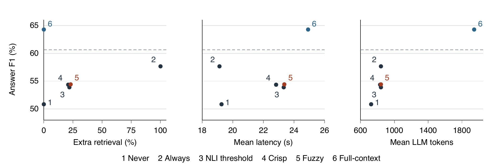

# V2 第 11 节实验结果与解读

A Fuzzy-NLI-based QA Chatbot System with Adaptive Retrieval

BNBU NLP 课程小组实验　｜　2026 年 11 月 16 日

在 1,000 道正式测试题上，Fuzzy 以 23.0% 的再检索率将答案 F1 从 Never 的 50.85% 提升到 54.42%。同输入硬规则取得 54.36%，实际再检索率为 20.9%，两种门控的配对差异区间覆盖零。在共用的 32 道计时题上，Always 的平均延迟低于 Fuzzy，Full-context 的正式答案 F1 最高。

### 实验是怎样比较的

<strong>数据与校准&#32;</strong>数据来自 HotpotQA distractor 的公开 validation 划分，仅保留 bridge 多跳题。使用种子 42 划成互斥的 100 道 DeepSeek 预实验题、500 道 Qwen 校准题和 1,000 道 Qwen 正式题。三种门控在校准集使用 20.0% 的目标触发率，锁定规则与阈值后逐题应用于正式集。

<strong>三种答案来源&#32;</strong>A 用 BM25 取首轮前两段。B 保留这两段，将题干、首段标题及首句组合成新查询，在未用段落中追加一段，再用相同的问答模型生成。Full-context 按原顺序一次提供全部候选段落。正式集的 A、B 和 Full-context 分别缓存，分支型策略共享同题的 A/B 输出。

<strong>门控输入&#32;</strong>NLI 衡量首轮证据对 A 答案陈述的支持程度，优先使用模型引用的段落。Fuzzy 与同输入硬规则都使用首轮 NLI 风险和词面桥接信号，后者检查任一首轮段落正文是否出现另一段的完整标题。Fuzzy 将风险映射为分段线性隶属度，硬规则用锚点中点作二值切分。两种策略分别在同一候选网格上独立选参，再锁定各自的决策边界。

### 三个样本量对应的结果

表 1&#32;&#32;实验读数与样本

<table>
<thead>
<tr>
<th>
样本
</th>
<th>
用途
</th>
<th>
记录位置
</th>
</tr>
</thead>
<tbody>
<tr>
<td>
1,000 道正式题
</td>
<td>
答案、句级证据、再检索率、门控与配对差
</td>
<td>
§11.1–11.3 　§11.5
</td>
</tr>
<tr>
<td>
六种策略共用 32 道题
</td>
<td>
真实路径延迟、调用及 token
</td>
<td>
§11.1 　§11.5
</td>
</tr>
<tr>
<td>
100 道预实验题
</td>
<td>
证据覆盖和是否进入正式方案
</td>
<td>
§11.4
</td>
</tr>
</tbody>
</table>

页码导读　正式质量 2｜实测成本 3｜逐题变化 4｜门控与消融 5｜预实验 6｜质量与成本图 7｜配对区间及归档 8

## 11.1 正式答案质量与再检索率

将官方 HotpotQA 评分先算到每一道题，再对 1,000 题取平均。答案 F1 衡量规范化后的词重叠，允许部分得分。EM 是规范化后完全匹配的题目比例。Supp-F1 按预测与金标的「段落标题、句子索引」集合计算。Qwen 句级选择器从生成器引用的段落中选句，因此 Supp-F1 同时反映段落引用和句级选择。

表 11-1A&#32;&#32;正式质量与再检索率

<table>
<thead>
<tr>
<th>
策略
</th>
<th>
答案 F1
</th>
<th>
EM
</th>
<th>
Supp-F1
</th>
<th>
校准目标
</th>
<th>
正式再检索率
</th>
</tr>
</thead>
<tbody>
<tr>
<td>
Never
</td>
<td>
50.85%
</td>
<td>
40.10%
</td>
<td>
47.51%
</td>
<td>
—
</td>
<td>
0.0%
</td>
</tr>
<tr>
<td>
Always
</td>
<td>
57.66%
</td>
<td>
46.20%
</td>
<td>
52.38%
</td>
<td>
—
</td>
<td>
100.0%
</td>
</tr>
<tr>
<td>
NLI 阈值
</td>
<td>
53.89%
</td>
<td>
42.70%
</td>
<td>
50.15%
</td>
<td>
20.0%
</td>
<td>
21.9%
</td>
</tr>
<tr>
<td>
同输入硬规则
</td>
<td>
54.36%
</td>
<td>
43.00%
</td>
<td>
50.22%
</td>
<td>
20.0%
</td>
<td>
20.9%
</td>
</tr>
<tr>
<td>
<strong>Fuzzy</strong>
</td>
<td>
54.42%
</td>
<td>
43.20%
</td>
<td>
50.24%
</td>
<td>
20.0%
</td>
<td>
23.0%
</td>
</tr>
<tr>
<td>
Full-context
</td>
<td>
64.27%
</td>
<td>
50.20%
</td>
<td>
54.90%
</td>
<td>
—
</td>
<td>
0.0%
</td>
</tr>
<tr>
<td>
A/B Oracle
</td>
<td>
60.61%
</td>
<td>
49.20%
</td>
<td>
51.35%
</td>
<td>
—
</td>
<td>
12.3%
</td>
</tr>
</tbody>
</table>

再检索率按采用第二轮路径的题数计算。Always 固定走 B。正式集有 1 题已无额外段落可用，仍按预定分支规则保留。Full-context 首轮即读入完整候选池，故其第二轮再检索率为 0.0%。Oracle 的 12.3% 是事后选 B 的比例。

### 逐项解释

<strong>Never 与 Always&#32;</strong>Never 提供首轮基准。Always 对所有题采用追加后的 B，答案 F1 增加 6.81 个百分点，EM 从 40.10% 增到 46.20%，Supp-F1 从 47.51% 增到 52.38%。这些平均值衡量整套 B 路径，逐题结果同时存在改善和变差。

<strong>三种门控&#32;</strong>NLI 阈值单独使用首轮证据支持度，以 21.9% 的再检索率将答案 F1 提高到 53.89%。同输入硬规则和 Fuzzy 都使用 NLI 与桥接信号，答案 F1 分别为 54.36% 和 54.42%。Fuzzy 的 EM 与 Supp-F1 分别是 43.20% 和 50.24%，两项也略高于硬规则。百分比均从未四舍五入的原始均值转换。

<strong>实际触发率&#32;</strong>两个同输入门控在校准集的目标同为 20.0%，正式集分别触发 209 题和 230 题。固定阈值逐题应用后，测试集分数分布会影响触发数量。比较两者时需同时看实际预算和表 11-5 的配对区间。

<strong>Full-context 与 Oracle&#32;</strong>Full-context 在答案 F1、EM、Supp-F1 三项均最高。它每题可读取完整候选池，证据预算与 A/B 分支不同。A/B Oracle 用金标答案 F1 逐题选优，同分选 A。60.61% 是本批固定 A/B 回答的答案 F1 上界，它对 EM 和 Supp-F1 不单独优化。

归档依据 \[1\] \[2\]。

## 11.1 真实路径延迟和计算用量

六种可执行策略在同一批 32 道正式题上计时。每种策略先跑 8 道校准题预热，正式请求并发 8。Qwen2.5-7B-Instruct 由 Tesla T4 上的 vLLM 提供，门控路径的 DeBERTa 在 CPU 上以四线程串行执行。延迟从开始检索或准备上下文计至最后一句级证据选择完成。

表 11-1B&#32;&#32;端到端秒数与平均每题 LLM token

<table>
<thead>
<tr>
<th>
策略
</th>
<th>
均值
</th>
<th>
P50
</th>
<th>
P90
</th>
<th>
P95
</th>
<th>
输入 token
</th>
<th>
输出 token
</th>
</tr>
</thead>
<tbody>
<tr>
<td>
Never
</td>
<td>
19.26
</td>
<td>
19.21
</td>
<td>
23.76
</td>
<td>
24.41
</td>
<td>
697.75
</td>
<td>
27.28
</td>
</tr>
<tr>
<td>
Always
</td>
<td>
19.13
</td>
<td>
18.77
</td>
<td>
22.56
</td>
<td>
23.56
</td>
<td>
814.66
</td>
<td>
26.38
</td>
</tr>
<tr>
<td>
NLI 阈值
</td>
<td>
23.32
</td>
<td>
22.47
</td>
<td>
28.87
</td>
<td>
31.11
</td>
<td>
810.19
</td>
<td>
30.84
</td>
</tr>
<tr>
<td>
同输入硬规则
</td>
<td>
22.83
</td>
<td>
21.71
</td>
<td>
28.61
</td>
<td>
31.21
</td>
<td>
800.94
</td>
<td>
30.28
</td>
</tr>
<tr>
<td>
<strong>Fuzzy</strong>
</td>
<td>
23.36
</td>
<td>
22.47
</td>
<td>
28.65
</td>
<td>
31.28
</td>
<td>
810.19
</td>
<td>
30.84
</td>
</tr>
<tr>
<td>
Full-context
</td>
<td>
24.91
</td>
<td>
24.46
</td>
<td>
29.67
</td>
<td>
31.41
</td>
<td>
1,916.75
</td>
<td>
27.78
</td>
</tr>
</tbody>
</table>

P50 是中位数。P90 和 P95 是第 90 和第 95 百分位数，用于描述较慢的请求。延迟和用量均来自这批 32 题。Oracle 依赖事后金标，表中延迟和用量仅列实测策略。

表 11-1C&#32;&#32;平均每题调用与计时子集触发率

<table>
<thead>
<tr>
<th>
策略
</th>
<th>
LLM 调用
</th>
<th>
NLI 调用
</th>
<th>
NLI 输入 token
</th>
<th>
子集再检索率
</th>
</tr>
</thead>
<tbody>
<tr>
<td>
Never
</td>
<td>
2.000
</td>
<td>
0
</td>
<td>
0.00
</td>
<td>
0.00%
</td>
</tr>
<tr>
<td>
Always
</td>
<td>
2.000
</td>
<td>
0
</td>
<td>
0.00
</td>
<td>
100.00%
</td>
</tr>
<tr>
<td>
NLI 阈值
</td>
<td>
2.219
</td>
<td>
1
</td>
<td>
159.28
</td>
<td>
21.88%
</td>
</tr>
<tr>
<td>
同输入硬规则
</td>
<td>
2.188
</td>
<td>
1
</td>
<td>
159.28
</td>
<td>
18.75%
</td>
</tr>
<tr>
<td>
<strong>Fuzzy</strong>
</td>
<td>
2.219
</td>
<td>
1
</td>
<td>
159.28
</td>
<td>
21.88%
</td>
</tr>
<tr>
<td>
Full-context
</td>
<td>
2.000
</td>
<td>
0
</td>
<td>
0.00
</td>
<td>
0.00%
</td>
</tr>
</tbody>
</table>

<strong>检索率与延迟&#32;</strong>Always 的平均延迟为 19.13 秒，Fuzzy 为 23.36 秒，相差 4.23 秒。Always 可以直接构造 B 并作答，再选一次句级证据。门控始终先作答 A、跑一次 NLI，触发后才追加检索和 B 作答。这些不同的调用路径解释了为何减少第二轮检索仍可能增加端到端延迟。单次测量无法估计各环节独立耗时。

<strong>调用与用量&#32;</strong>NLI 阈值和 Fuzzy 在 32 道题上分别触发 7 题，同输入硬规则触发 6 题，三者的正式集触发率见表 11-1A。Full-context 平均输入 1,916.75 token，其平均输出 27.78 token。相对 Fuzzy，成本差主要体现在输入，LLM token 包含答案生成和最终选句。

归档依据 \[2\] \[3\]。端到端延迟比较是本机配置下的描述性读数。

## 11.2 逐题改善持平与变差

先以 Never 的 A 答案作同一道题的基准，再比较策略实际交付答案的官方 F1。差值严格大于零为改善，等于零为持平，严格小于零为变差。F1 持平只说明官方分数相等，答案文字和引用仍可能发生变化。

表 11-2&#32;&#32;相对 Never 的最终答案变化&#32;&#32;全部 1,000 题

<table>
<thead>
<tr>
<th>
策略
</th>
<th>
改善
</th>
<th>
持平
</th>
<th>
变差
</th>
</tr>
</thead>
<tbody>
<tr>
<td>
Always
</td>
<td>
123（12.3%）
</td>
<td>
827（82.7%）
</td>
<td>
50（5.0%）
</td>
</tr>
<tr>
<td>
NLI 阈值
</td>
<td>
49（4.9%）
</td>
<td>
934（93.4%）
</td>
<td>
17（1.7%）
</td>
</tr>
<tr>
<td>
同输入硬规则
</td>
<td>
54（5.4%）
</td>
<td>
932（93.2%）
</td>
<td>
14（1.4%）
</td>
</tr>
<tr>
<td>
<strong>Fuzzy</strong>
</td>
<td>
56（5.6%）
</td>
<td>
927（92.7%）
</td>
<td>
17（1.7%）
</td>
</tr>
<tr>
<td>
A/B Oracle
</td>
<td>
123（12.3%）
</td>
<td>
877（87.7%）
</td>
<td>
0（0.0%）
</td>
</tr>
</tbody>
</table>

<strong>Always&#32;</strong>每题使用 B，给出 B 相对 A 的完整分布。123 题从追加路径获益，50 题分数下降，827 题的分数持平。由此定义整个门控任务的 123 个正例。平均质量提升与逐题损害同时存在。

<strong>三种门控&#32;</strong>NLI 阈值、同输入硬规则、Fuzzy 分别留下 49、54、56 个改善，以及 17、14、17 个变差。三者都减少了 Always 中的变差，同时失去部分原本可改善的题。Fuzzy 与同输入硬规则的边际差是多触发 21 题，最终改善多 2 题、变差多 3 题。该差值是总数之差，两个门控的选题集合各自也有变化。

<strong>两个分母&#32;</strong>Fuzzy 的 927 个持平含 770 个沿用 A 的未触发题，以及 157 个触发后 F1 持平的题。若要问触发后有多少题真正改善，分母应取 230，得到 56/230，即 24.3%。若要问全体用户题目中得到改善的比例，分母取 1,000，得到 5.6%。

<strong>Oracle&#32;</strong>事后选支覆盖所有 123 个改善题，并把其余 877 题交给 A，因此按答案 F1 定义没有变差。它需要事先知道两个分支的官方分数，用来量化可争取的质量上限。

<strong>计数与平均 F1&#32;</strong>题数统计只看变化方向。每题 F1 的变化幅度可不同，所以 Fuzzy 可以在改善多 2 题且变差多 3 题的同时，平均答案 F1 比同输入硬规则略高。平均差和不确定度以表 11-5 为准。

归档依据 \[2\] \[4\]。

## 11.3 门控选题质量与消融

将「B 的答案 F1 严格高于 A」定义为正类，共 123 题。门控精确率（P）是触发后真正改善的比例，召回率（R）是 123 个可改善题中成功触发的比例，门控 F1 是 P 与 R 的调和平均。这个 F1 评价选题，表中的答案 F1 评价最终作答。

表 11-3&#32;&#32;门控与消融&#32;&#32;触发构成按改善／持平／变差排列

<table>
<thead>
<tr>
<th>
策略
</th>
<th>
答案 F1
</th>
<th>
再检索率
</th>
<th>
触发构成
</th>
<th>
门控 P
</th>
<th>
门控 R
</th>
<th>
门控 F1
</th>
</tr>
</thead>
<tbody>
<tr>
<td>
NLI 阈值
</td>
<td>
53.89%
</td>
<td>
21.9%
</td>
<td>
49 / 153 / 17
</td>
<td>
0.224
</td>
<td>
0.398
</td>
<td>
0.287
</td>
</tr>
<tr>
<td>
同输入硬规则
</td>
<td>
54.36%
</td>
<td>
20.9%
</td>
<td>
54 / 141 / 14
</td>
<td>
0.258
</td>
<td>
0.439
</td>
<td>
0.325
</td>
</tr>
<tr>
<td>
<strong>Fuzzy</strong>
</td>
<td>
54.42%
</td>
<td>
23.0%
</td>
<td>
56 / 157 / 17
</td>
<td>
0.243
</td>
<td>
0.455
</td>
<td>
0.317
</td>
</tr>
<tr>
<td>
Fuzzy 去掉 NLI
</td>
<td>
56.82%
</td>
<td>
66.0%
</td>
<td>
100 / 523 / 37
</td>
<td>
0.152
</td>
<td>
0.813
</td>
<td>
0.255
</td>
</tr>
<tr>
<td>
Fuzzy 去掉桥接
</td>
<td>
53.79%
</td>
<td>
20.7%
</td>
<td>
47 / 145 / 15
</td>
<td>
0.227
</td>
<td>
0.382
</td>
<td>
0.285
</td>
</tr>
</tbody>
</table>

<strong>NLI 阈值&#32;</strong>219 次触发中选中 49 个改善题。它的精确率和召回率是 0.224 和 0.398，作为完整门控的单信号参照。采用 Fuzzy 后，触发次数与命中的改善数都上升，答案 F1 提升的区间见表 11-5。

<strong>Fuzzy 与硬规则&#32;</strong>同输入硬规则在三种完整门控中精确率和门控 F1 最高（0.258 和 0.325）。Fuzzy 选中 56/123 个改善题，召回率 0.455，略高于硬规则的 54/123 和 0.439。Fuzzy 同时选入更多持平和变差题，精确率为 0.243，因此门控 F1 为 0.317。

<strong>去掉 NLI&#32;</strong>将每题 NLI 风险固定为锁定锚点的中点，保留桥接逻辑和原决策边界。触发率从 23.0% 扩至 66.0%，命中的改善题从 56 增至 100，变差从 17 增至 37。F1 升到 56.82%，门控召回升到 0.813，精确率降到 0.152。较高的答案分数是在明显更大的再检索预算下获得的。

<strong>去掉桥接&#32;</strong>采用原规则缺桥接时的回退，仅使用 NLI 隶属度，仍沿用完整门控的原边界。触发率降至 20.7%，改善题减到 47 个，门控召回降到 0.382，答案 F1 降至 53.79%。与单阈值 NLI 对照相比，该消融保留了 Fuzzy 的 NLI 隶属度和锁定边界。

<strong>消融口径&#32;</strong>两项消融保留已有规则和阈值，使读者看到移除某项输入后原策略如何变化。答案 F1 差同时包含选题改变和触发预算改变。等预算的输入贡献需要另有对照。

归档依据 \[1\] \[2\]。

## 11.4 预实验覆盖率与 GO 判定

预实验使用 100 道独立题、deepseek-chat 和本地 DeBERTa，检验一次追加检索能否提供足够的答案质量余量。结果用于决定是否进入校准和正式评估。

表 11-4A&#32;&#32;预实验三项读出

<table>
<thead>
<tr>
<th>
读出
</th>
<th>
观察结果
</th>
</tr>
</thead>
<tbody>
<tr>
<td>
两段金标段落均被检索到
</td>
<td>
A 31/100 → B 59/100
</td>
</tr>
<tr>
<td>
B 相对 A 的答案变化
</td>
<td>
16 改善／82 持平／2 变差
</td>
</tr>
<tr>
<td>
A/B Oracle 相对 A
</td>
<td>
+13.7 个百分点，配对 95% CI [+7.7, +20.3]
</td>
</tr>
</tbody>
</table>

<strong>证据覆盖&#32;</strong>双金标覆盖从 31% 增至 59%，说明第二轮常能补齐金标段落。覆盖率只检查候选段落层级。预实验归档只有段落级引用，所以用该指标登记。正式实验的句级 Supp-F1 还要求模型选中正确的句子。

<strong>答案变化&#32;</strong>平均答案 F1 从 A 的 62.8% 升至 B 的 75.2%，Oracle 为 76.5%。EM 从 52.0% 升至 65.0%。有 82 题的 F1 持平，说明追加路径只对部分题改变得分。Oracle 相对 B 的 F1 增量约 1.3 个百分点，预实验中事后跳过有害的 B 贡献较小。

表 11-4B&#32;&#32;预先登记的四项判定

<table>
<thead>
<tr>
<th>
检查项
</th>
<th>
阈值
</th>
<th>
读数
</th>
<th>
判定
</th>
</tr>
</thead>
<tbody>
<tr>
<td>
Oracle 增益点估计
</td>
<td>
≥ 5.0 个百分点
</td>
<td>
+13.7 个百分点
</td>
<td>
通过
</td>
</tr>
<tr>
<td>
增益 95% CI 下界
</td>
<td>
&gt; 0
</td>
<td>
+7.7 个百分点
</td>
<td>
通过
</td>
</tr>
<tr>
<td>
改善题比例
</td>
<td>
≥ 10.0%
</td>
<td>
16.0%
</td>
<td>
通过
</td>
</tr>
<tr>
<td>
变差题数 ÷ 改善题数
</td>
<td>
≤ 0.5
</td>
<td>
2 ÷ 16 = 0.125
</td>
<td>
通过
</td>
</tr>
</tbody>
</table>

<strong>阈值依据&#32;</strong>点估计下限要求余量达到团队认为值得研究的水平，区间下界要求与零增益区分。改善题比例下限为后续选题比较保留一定的正例，变差与改善的计数比检查追加路径是否频繁造成损害。数字阈值属于主观、预注册的研究设计。

四项通过，结论为 GO，即进入后续门控实验。预实验与正式实验采用不同题目和作答模型，各自按自己的样本解读。归档依据 \[1\] \[5\]。

## 11.5 质量与成本的三个维度

图中每个点的纵坐标都是 1,000 道正式题的平均答案 F1。左图横轴为同一批题的再检索率，中图和右图横轴分别为 32 道共用题的平均端到端延迟和平均总 LLM token。总 LLM token 为输入加输出，CPU NLI 的 token 在表 11-1C 单列。

图 11-1&#32;&#32;六种策略的答案 F1 随成本的分布

编号依次为 1 Never、2 Always、3 NLI 阈值、4 同输入硬规则、5 Fuzzy、6 Full-context。虚线表示 A/B Oracle 的答案 F1。图中点为估计值，答案 F1 配对区间见表 11-5。

<strong>左图&#32;&#32;再检索&#32;</strong>Fuzzy 相对 Always 的再检索率从 100.0% 减至 23.0%，平均答案 F1 低 3.233 个百分点。Full-context 也出现在横轴零点，因为它一次读入完整候选池。该横轴反映追加检索频率，首轮读取的上下文量要另外看。

<strong>中图&#32;&#32;延迟&#32;</strong>Never 和 Always 位于左侧。Fuzzy 的平均时延为 23.36 秒，比 Always 多 4.23 秒。Full-context 平均 24.91 秒，比 Fuzzy 多 1.55 秒，同时取得最高的答案 F1。两项结果由本次硬件、模型与执行路径共同决定。

<strong>右图&#32;&#32;LLM token&#32;</strong>Full-context 每题平均使用 1,944.53 个 LLM token，Fuzzy 使用 841.03 个，约为 Fuzzy 的 2.31 倍。在这批每题至多十个候选段落的题上，完整上下文可以用更多 token 换取更高 F1。两个门控的点在各轴上靠近，比较微小质量差时要结合表 11-5。

本图展示追加检索频率、端到端延迟和文本用量三种成本。报告质量与成本时应同时给出对应读数。延迟和 token 的策略间差异属于本次实测描述。归档依据 \[2\] \[3\] \[7\]。

## 11.5 五项配对差异的解读

每项比较先算同一道题上左侧策略减右侧策略的答案 F1，再以题为单位有放回抽取 1,000 个配对差。重复 10,000 次，使用种子 42，取样本均值的第 2.5 与 97.5 百分位数。五项比较均在正式结果揭晓前登记。区间逐项报告，未经多重比较校正。

表 11-5&#32;&#32;预注册配对答案 F1 差异&#32;&#32;单位为百分点

<table>
<thead>
<tr>
<th>
预注册对比
</th>
<th>
平均差
</th>
<th>
95% 配对区间
</th>
</tr>
</thead>
<tbody>
<tr>
<td>
Fuzzy − 同输入硬规则
</td>
<td>
+0.064
</td>
<td>
[-0.365, +0.517]
</td>
</tr>
<tr>
<td>
Fuzzy − NLI 阈值
</td>
<td>
+0.531
</td>
<td>
[+0.155, +0.994]
</td>
</tr>
<tr>
<td>
Fuzzy − Never
</td>
<td>
+3.576
</td>
<td>
[+2.265, +4.914]
</td>
</tr>
<tr>
<td>
A/B Oracle − Never
</td>
<td>
+9.758
</td>
<td>
[+8.059, +11.471]
</td>
</tr>
<tr>
<td>
Full-context − Fuzzy
</td>
<td>
+9.841
</td>
<td>
[+7.098, +12.614]
</td>
</tr>
</tbody>
</table>

<strong>Fuzzy − 同输入硬规则&#32;</strong>区间覆盖零及两侧的小幅差值。Fuzzy 与硬规则共享信号，但正式触发率分别为 23.0% 与 20.9%。这项结果未确立模糊推理的独立优势。等效判断还需要既定的可接受差异范围。

<strong>Fuzzy − NLI 阈值&#32;</strong>配对区间全在零以上，支持 Fuzzy 的平均答案 F1 高于单阈值策略。两套冻结策略的输入、决策形式及实际触发率都不同，观测差值反映组合后的整体表现。

<strong>Fuzzy − Never&#32;</strong>区间下界为 +2.265 个百分点。在 23.0% 的正式再检索率下，整套门控的平均答案 F1 高于只作答 A。

<strong>A/B Oracle − Never&#32;</strong>事后只对有益的题切换到 B，有接近 10 个百分点的平均答案 F1 余量。这个区间衡量已生成 A/B 分支中可回收的余量，实际门控必须根据首轮信息预测哪些题值得触发。

<strong>Full-context − Fuzzy&#32;</strong>区间整体为正，表明该小候选池中 Full-context 的答案 F1 更高。它以不同的阅读预算取得这个结果，延迟和 token 见表 11-1B。该区间反映对冻结系统按题重采样的差异，适用范围是本次数据与设置。

### 归档索引

\[1\] exp/EXPERIMENT\_LOG.md&#32;&#32;·&#32;&#32;预注册、运行和结果登记

\[2\] step5\_v2/quality\_summary.json 与 step5\_v2/per\_question.csv&#32;&#32;·&#32;&#32;正式质量与选题

\[3\] step5\_v2/latency\_summary.json&#32;&#32;·&#32;&#32;真实路径计时和用量

\[4\] step6\_v2/step6\_summary.json&#32;&#32;·&#32;&#32;逐题变化及配对结果汇总

\[5\] 项目根目录 per\_question.csv&#32;&#32;·&#32;&#32;DeepSeek 预实验逐题记录

\[6\] step6\_v2/paired\_bootstrap.csv&#32;&#32;·&#32;&#32;配对差的未舍入读数

\[7\] step6\_v2/quality\_cost.pdf&#32;&#32;·&#32;&#32;质量与成本图的矢量原图

<!-- footer1.xml -->

<blockquote>
V2 第 11 节实验结果　｜　<!-- Word field: PAGE -->
</blockquote>
