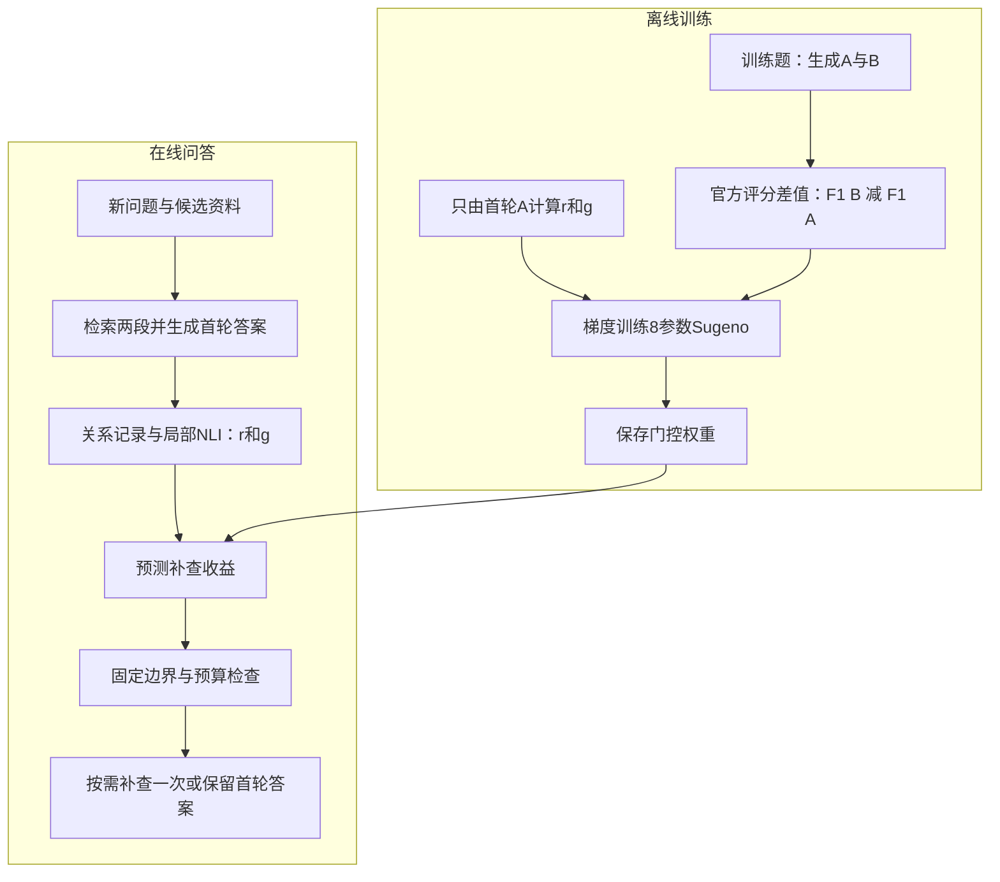

# V3.1：长文本量、关系级 NLI 与可学习模糊门控完整方案

日期：2026-11-16。状态：已纳入门控监督训练，供开发 AI 执行；尚未实施、尚未训练，无 V3.1 结果。

> 后续全局复核：先读 [GLOBAL_REVIEW.md](GLOBAL_REVIEW.md)。训练与复杂关系模块是条件性扩展；在P2前插入P1.5固定检索/全文/补查分支能力预检，确认可争取空间，再决定投入训练。本文件各模块不再视为全部必做。

配套文件：[训练详细规范](TRAINING_SPEC.md)、[开发 AI 任务单](AI_TASK.md)。README 为系统与实验总方案，TRAINING_SPEC 规定训练的精确定义，AI_TASK 规定执行顺序。

本文件取代工作区早期《V3_逐跳证据核验_执行方案.md》作为后续开发依据。现有 V2 的代码、数据、配置和结果继续作为历史基线保存。

## 1. 我们最终要交付什么

项目题目继续使用 A Fuzzy-NLI-based QA Chatbot System with Adaptive Retrieval，主方向仍为 Topic 2：Fuzzy Logic with Natural Language Inference。

成品是一个基于指定资料回答问题的 QA 系统：先检索少量材料，生成答案；检查答案及必要关系的证据支持；用经过训练的模糊门控预测补查收益，结合预算决定是否针对缺失关系补查一次；显示答案、原文引用及补查理由。实验部分检验：随着候选文本量增加，该方法能否在接近的质量下减少累计模型输入，或在相近成本下提高质量；NLI 改进、模糊结构与学习参数分别贡献多少。千问和 NLI 权重冻结；我们训练的是小型模糊收益预测器。

“更省 token”“模糊门控更优”均是待验证假设，不作为预定结论。普通规则或全文阅读可以胜出。

## 2. 已确认条件与待实测事项

| 项目 | 当前依据/处理 |
|---|---|
| 团队 | 7 人，能使用 Python 和 AI 辅助开发；既往主要开发由两位负责人推进 |
| 预算 | 学生预算有上限，具体金额和当前剩余算力未确认；不编造金额 |
| 作答模型 | V2 使用 Qwen/Qwen2.5-7B-Instruct，固定 revision a09a35458c702b33eeacc393d103063234e8bc28 |
| NLI | V2 使用 MoritzLaurer/DeBERTa-v3-large-mnli-fever-anli-ling-wanli，固定 revision b3546ea6b0346eb6f8d5d68b13c7dc6d0376b3d7 |
| 当前服务长度 | V2 实际 max-model-len=4096，不是模型名义最大能力；扩大前必须重新检查硬件、并发与 KV cache |
| NLI 长度 | 当前输入上限 512 tokens；不会因为千问上下文扩大而自动扩大 |
| 已完成实验 | 100 pilot + 500 tune + 1000 formal，ID 互斥；全部历史已用样本仍须代码核对 |
| 当前限制 | 10 段中 Full-context 质量高于现有门控；Fuzzy 对 Crisp 无明确优势；不能声称现有流程更实用 |
| 预算与时间 | 先以 50 题小实验测量；正式规模与预计费用据实锁定 |

本阶段保持模型身份；延长上下文、改变并发或设备必须写入 V3 配置，不能与 V2 的原时延直接相减。所有方法在相同 V3 服务条件下重测。

## 3. 数据路线：主实验与书本演示

### 3.1 主实验先扩展已有问答材料池

原因：保留现有答案、支持句和官方评分接口，便于确认改进来自算法；直接换整本书会同时改变题型、语言、证据标注和评价。

工程原型先从既有 pilot 中取 50 题；原 V2 的 500 道 tune 按问题 ID 固定拆分为约 400 训练、100 验证。先取其中100/50做训练烟雾和费用估算，再按预算扩大。训练集更新权重，验证集选超参数/早停/行动边界，两者不能混用。

正式 V3.1 优先从尚未用于任何历史实验或人工诊断的 bridge ID 中封存新最终集，先以300题作费用规划候选。验证全部历史 ID 清单；同题多文本规模不能跨训练/验证/测试划分。最终数量在看最终成绩前根据资源与开发差异方差确定，不能追加题目追求显著。400道训练题不保证泛化，300道最终题不保证识别小优势。第一版在一个主要可行文本规模训练，各规模复用同一模型；详情见 TRAINING_SPEC。

建议候选池阶梯为 10/30/60 段，100 段后置。段数与实际 token 同时报告，不将段数当作文本量。构建方式：保留原 10 段，再从独立的、预先固定的语料来源补充不重复段落。优先用 HotpotQA 官方训练材料建立补充段落池；不得从封存最终题的问答/标签中挑选额外段落。按规范化标题+正文哈希去重，记录版本与来源。

随机负例与 BM25 难负例建议各一半，比例是初始方案，开发前登记。难负例只用问题检索，不能用标准答案、gold 支持句或未来补查查询挑选。BM25 的整个排名必须在该规模的完整候选池上计算。10⊂30⊂60 保持嵌套，固定随机种子与排序种子。不要反复换随机种子直到本方法赢。

基础 10 段属于包含标准支持材料的 distractor 设计；因此扩展后仍保证原支持材料在池中。这是受控候选池实验，不能宣传为真实开放域全库检索。数据构建器可以持有标签用于质量检查，但在线组件接收的对象必须去掉 answer/supporting_facts。

### 3.2 全文输入可行性优先于段数目标

构建后先对所有候选规模用实际 Qwen tokenizer 统计完整 chat prompt 与输出预留长度。服务长度实测从现有 4096 开始，必要时试 8192、16384；这些是待验证配置，不是已可用资源。降并发后仍 OOM 则降低全方法共同规模或更换满足容量要求的设备，不能悄悄截掉 Full 的关键材料。

主比较使用所有方法都可完整运行的共同题目和规模，题目纳入规则按文本长度事前确定，与答案成绩无关。记录排除数和范围。超过可行上下文的额外检索实验可以单列，但 Full 标为不可运行；不能因其无法装入就算答错，更不能宣称质量优于全文。

Full 使用固定的候选顺序，并把 gold 的位置随机化/跨题平衡，避免总把关键证据放开头。主结果固定一个次序；开发阶段补做少量位置敏感性检查。排序规则所有策略可见且固定。

### 3.3 书本作为小型外部演示，随后再考虑正式外部验证

可用一份获准使用、来源清楚的长文本，切成约 200–400 个 Qwen tokens 的句子完整块，适度重叠，并保留章节/句子/字符位置。参数先开发锁定，不按结果挑切分。英文为第一版，避免现有英文 NLI 与中文书籍的语言错配。

先做 20–30 道人工核实的跨段事实题：一个问题依赖两条有联系的事实；记录答案、证据链、可接受措辞。避免主观人物动机题。AI 出题后必须人工核对，且不能仅挑某种方法失败的问题。重复重叠句评分需映射回原句，避免把相同证据算成多条。

该批题用于演示/探索，不替代主实验，也不能用其几十题结果泛化所有书籍。若扩大，按书籍/章节来源隔离开发与最终题；同一本书换题不等于跨书泛化。加入无上下文 Qwen 对照检查模型记忆。先在同文档事实连接任务验证，不扩展复杂数学或开放式文学推断。

## 4. 新流程与模块边界

问题→BM25 top-2→Qwen 草稿答案和段落引用→关系/证据记录→局部 NLI 核验→训练后的模糊收益预测器＋预算决策→若触发，生成缺口查询并从未用材料检索 top-1→同一 Qwen 重新回答→句级引用选择→输出。

主版最多一次额外检索，保留原 k=2,m=1；如果开发诊断表明补一块不足，可另立 m=2 扩展，但必须所有相关对照使用相同上限并重新锁定。不要增加无限循环。

三种身份必须分开：Qwen 提出拆解/提取/查询；NLI 对明确陈述与证据评分；代码维护状态、执行规则、验证编号与约束。Qwen 输出的“证据充分”不是最终标准标签。在线核验不能检索整本书来假装已知全部信息。

建议新增 exp/v3/（实际目录按审计映射）：data.py、records.py、verify.py、query.py、gates.py、train_gate.py、pipeline.py、evaluate.py、run.py、configs/、tests/、reports/、app/。复用旧只读接口，不覆盖原文件。

### 离线训练与在线使用的关系



在线没有标准答案，也不提前知道B是否正确。训练中的实际收益用于学习，在线只有预测收益。

## 5. NLI 改进：从整题模板到可检查的关系

### 5.1 必要关系记录

输入：问题、首轮已检索原文、草稿答案/引用。输出 JSON：

```json
{
  "qid": "example",
  "requirements": [
    {"id": "r1", "relation": "recipient_of_letter", "subject": "Lin Zhou", "object": "Lin Yue", "claim": "Lin Zhou gave the letter to Lin Yue.", "status": "candidate", "evidence_ids": ["c02:s3"]},
    {"id": "r2", "relation": "settled_in", "subject": "Lin Yue", "object": null, "claim": null, "status": "unresolved", "evidence_ids": []}
  ],
  "bridge_entity": "Lin Yue",
  "missing_relation_ids": ["r2"],
  "parse_error": false
}
```

虚构示例只说明字段。关系数量允许 1–4，不能强迫每题恰好两条。UNKNOWN、指代不清、实体同名和分解失败保留标记。对未识别对象，不编造断言送入 NLI。所有 evidence_ids 必须对应已检索原文；Qwen 自造引文无效。已知关系的声明仍须核验，不因为 Qwen 填入就视为成立。

关系记录暂用一次单独 Qwen 调用，输出上限初设 512 tokens，计入成本；不继承原答案 128 tokens 上限。保存 raw JSON、解析失败和回退。已有早期转述探测曾有 UNKNOWN/回退问题，因此这一步必须先人工验证，不能假设自然语言改写必然更准。

### 5.2 证据选择与局部 NLI

逐个有明确 claim 的关系核验。对其引用句及相邻必要句组成短证据束，不超过 512 tokens 的 NLI 总输入上限；过长时按句界分束，记录实际覆盖/截断，不能无记录截断。先限制每题最多 4 次局部 NLI；证据束选择只用已检索文本。

NLI 为每个关系输出 E/N/C 三态分数。它们不是已校准正确率，也不是互相独立的三个特征。比较原整题模板和关系级输入的人工一致性。需要联合证据的 claim 允许把相关句放在同一个证据束中，不能只取逐句最大支持分数就声称证据链完整。

区分：claim 是否忠实表达题目和草稿；原文是否支持 claim；这些 claim 是否覆盖完整问题。三项分别抽查。低 E 可能来自关系提取错误、NLI 误判或证据确实缺失。neutral 不自动等于可通过补查解决。

### 5.3 第一版信号

- r：已明确、可核验关系中的最低 E 对应风险，即 1-min(E)。没有任何可核验关系时为不可用，不伪造 E=0。
- g：记录中未得到可接受支持的必要关系比例，是模型辅助估计的覆盖缺口，不是 gold 证据缺口。E 阈值仅开发集选择。必须区分“明确缺失”和“解析未知”。
- c：最大冲突分数与实体不一致标记用于诊断/解释，暂不默认加入第三组模糊变量。

r 与 g 可能相关。先做诊断和消融，不能把相同低支持分数重复编码当作新信息。解析失败回退到 V2 原 NLI+代理信号（书本不使用标题代理，回退只用原 NLI），失败率及成本保留，不能把失败样本删掉。

## 6. 可学习模糊门控：真正训练一个小模型

精确定义与超参数见 [TRAINING_SPEC.md](TRAINING_SPEC.md)。以下为系统级摘要。

**监督数据。** 对每个训练题都生成固定A/B两分支。输入r、g只能由首轮信息计算；标签是官方答案分数的连续差值 y=F1(B)-F1(A)，保留提高、持平和退化。B内容/评分和标准答案只供离线标签程序使用，不进入在线特征。

**模型。** 使用零阶Sugeno，两个输入各有低/高隶属度，形成LL/LH/HL/HH四规则。高隶属函数为有界中心和宽度的sigmoid；学习两个中心、两个宽度、四个规则后件，共8个标量。后件可正可负，输出预测F1增量，不能称为正确率或补查概率。

**训练。** 使用MSE回归真实增量，加小型L2正则，CPU/PyTorch/Adam优化；验证集早停。先训练100题、验证50题检查实现及标签，再视预算扩大至400/100。训练运行3个预定种子并保存权重、损失曲线、参数轨迹和数据哈希，最终集不能用于选seed或checkpoint。第一版不用额外GPU训练门控；主要费用来自生成训练缓存。

**决策。** 先对预测增量在验证集校准行动边界，形成不同投入点；再可选加入基于train统计的追加token估计进行成本敏感决策。每次实际模型调用前检查token上限和累计预算，耗尽则记录原因，不将停止解释为证据充分。NLI和关系提取成本单列。即使触发次数相近，不同策略总token也可能不同。

**基线。** 保留固定/校准Fuzzy、同输入硬规则、连续加权、NLI阈值；新增同输入的线性收益回归和常数均值预测器。训练Fuzzy需要优于简单学习方法才有相应证据；仅有训练过程不等于有优势。消融包括只学习后件、固定隶属函数，与完整8参数学习比较。

关系失败回退沿用第5节，所有策略使用相同失败处理并报告比例。风险和覆盖缺口可能相关，必须检查实际信号价值。不强制风险越高收益越大，因为高风险也可能是不可解决的问题或核验错误。

旧固定规则表不再作为训练版的最终参数；完整训练结果必须能从checkpoint复原，不能只保存人工选阈值就称为权重训练。成本特征、三输入规则或NLI微调为后置扩展，第一版不增加。

## 7. 定向补查与引用

缺口查询由已确认的实体与待查关系组成。示例：Lin Yue + place of settlement。简单关系用模板拼接，不能处理的关系可用一次 Qwen 生成查询（建议上限 64 输出 tokens），额外调用必须计数。实体未确认则优先查首个未解决关系；无法生成有效查询时回退 V2 查询并记录原因。查询模块只能看问题和首轮材料/记录，不读新材料或标签。

对所有门控，第二分支使用同一缺口查询与同一检索结果，不能因知道某门控选择而改变 B 的生成。若依赖首轮答案/记录生成新查询，Always 分支也必须计入这些必要步骤。另保留“原规则查询＋直接读 3 段”的便宜基线，不强迫它执行无用的核验。

最终句级引用模块各方法使用同一代码和输出规则；选句只用最终可见材料。引用修复作为独立开关后置，不能在第一轮只为 Fuzzy 补充引用。正确答案、引用命中、逻辑证据充分分别评价。

## 8. 对照与消融：先分模块，再比完整系统

### 8.1 开发阶段分步归因

1. 扩展数据池，保持 V2 方法，确认不同文本量下的质量与成本。
2. 保持首轮输出和原 A/B 分支，比较原 NLI 信号和关系级信号。
3. 固定门控信号，比较原查询与缺口查询。
4. 在新信号/新查询固定后，构建训练/验证A/B标签，训练8参数Sugeno与线性收益回归；比较固定规则、固定Fuzzy和训练Fuzzy。冻结上游组件后才能生成正式训练标签。

必要时做原/新核验 × 原/新查询四组合。先小样本，避免将全部变动混成一个“V3 提高了”。

### 8.2 最终对照

| 方法 | 作用 |
|---|---|
| 无上下文 Qwen | 检查凭记忆能答多少，不属于证据检索方案 |
| Full-context | 完整读取同一池内材料，可运行时必须保留 |
| BM25 固定 top-2/top-3/top-6 | 检查普通检索是否已足够，top-6 需长度可行 |
| V2 门控与原查询 | 旧方法在同一新数据/环境的参考，不引用旧分数直接相减 |
| Qwen 自检门控 | 同首轮输出，由同一 Qwen 判断证据是否足够/是否补查；核验与查询调用计费 |
| 新信号 NLI 阈值/硬规则/连续加权/固定Fuzzy | 识别新信号与非学习控制规则的贡献 |
| 训练Fuzzy/线性收益回归/常数预测 | 比较同输入、同训练标签下的学习贡献与模糊结构 |

门控比较共享首轮答案、新 B 答案、引用选择和同一份可用信号；必要时对 Qwen 自检设独立提示，但它不得看到更多材料或 gold。固定检索基线直接作答，可省去不必要的首轮核验。由新查询依赖导致的规划成本不省略。

模型调用可缓存共享，九种策略不等于九次生成所有答案。先计算每题 A、原查询 B、新查询 B、Full、固定 top-6 所需输出，再离线选支评价；第一阶段不强制所有对照同时跑全量。成本必须按各自真实路径实测，不能用缓存命中耗时当推理耗时。

主消融：去关系级核验（换回原模板），去实体/覆盖信号（仅 NLI），去定向查询（换回原查询）。每项在开发重新校准预算，保留累计成本。主要终点优先锁定训练Fuzzy vs 固定Fuzzy、训练Fuzzy vs 线性收益回归；硬规则/连续分数提供辅助对照。另比较固定隶属函数只训练后件与完整训练。所有学习方法共享train/val与A/B标签；超参和运行边界只用验证集选择。完整系统与固定检索/Full的取舍另报，不能将其差异全归于模糊结构。

## 9. 指标、成本和判定规则

质量：答案 EM/F1、官方 supporting-fact F1；扩展候选池保持原句索引映射。另对共同最终样本做 50–80 题预先抽样的人工引用充分性审查，隐藏方法身份，部分双人独立标注。分层抽样需报告分层及权重，不能把便于展示的案例当总体比例。书本题采用人工答案和证据评测，不能套用原金标。

训练诊断：训练/验证MSE、学习曲线、规则参数、分组预测误差、跨种子变化和模型回退覆盖；训练标签仅为答案F1变化，不能因此宣称证据质量改善。

门控：选中改善/持平/变差的数量、漏掉的改善、额外检索证据召回。正例定义仍是相同分支下 B 比 A 的答案 F1 提高，不把低 NLI 或命中 gold 等同于收益。引用收益独立评价。

成本：逐题记录所有 Qwen 输入/输出 tokens（包括角色提示、关系记录、查询、重复上下文和选句）；NLI 调用数及输入 tokens 单列；端到端秒数、P50/P95、设备和并发。不同模型 token 不直接相加当作金额。费用仅基于真实计价或服务器账单。总预算同时保留问答输入上限和实际运行成本。另报告离线训练数据生成总量/成本与门控优化成本；部署每题成本与训练成本分列，需要声称总成本节约时给出摊销口径。

主图：同一文本规模下答案 F1–累计 Qwen 输入曲线、F1–端到端延迟曲线；跨规模画质量/成本趋势。对任一两个方法，只有质量与成本都不差且至少一项更好，才可说该点占优。若可接受损失设 1 个 F1 百分点，这只是团队要在正式测试前确认的容忍标准，不是结果出来后放宽。要声称“不劣”，需按配对差区间检验预设容忍界；差异不显著不等于质量相同。

统计以题目为单位配对 bootstrap，保留同题多规模结果的关联；声明主要比较和探索性比较范围。成本为真实共同样本测量（建议 50 题起、运行条件固定），保留失败和重试。重复计时顺序轮换，预热单列；不把单次小测量外推所有硬件。

## 10. 里程碑与通过条件

| 阶段 | 任务与交付物 | 扩大前的条件 |
|---|---|---|
| P0 审计，约半天–1天 | 当前版本、模型、预算资源、历史 ID、源码映射；长度与显存报告 | 找到真实依赖；明确可运行共同长度与费用估计 |
| P1 数据，约1天 | 50 开发题的嵌套候选池、哈希清单、长度/证据位置报告 | 各方法同池；无重复/泄漏；Full 不截断；金标仅评价器可见 |
| P2 核验，约1–2天 | 关系记录、原/新 NLI、人工核验表 | 20–30 题人工检查；编号100%可定位；结构解析成功率目标≥95%；关系忠实率目标≥90%，这些是工程门槛，不是研究效果承诺 |
| P3 查询与标签，约1–2天+推理 | 定向补查、冻结上游、训练/验证A/B缓存与增量标签 | 标签可复算；在线无B/gold；预算实测；失败有回退 |
| P4 门控训练，约1–2天 | 固定Fuzzy、训练Fuzzy、线性回归、权重、损失曲线与消融 | 权重真实更新且可复现；qid不泄漏；验证早停；全部预定seed保留 |
| P5 校准与最终，约2–3天+算力 | 冻结配置/权重、新最终题、主比较、区间和成本图 | 预测收益不冒充概率；测试不调参；不同规模不偷偷重训 |
| P6 展示与论文，约1–2天 | 最小 Chatbot 页面、案例、训练/方法/实验/限制 | 展示与模型日志一致；各位组员可解释训练及结果 |

加入训练后，阶段估计合计约9–14个工作日，额外模型推理等待可能延长。工期是两个主要开发者借助 AI、其他成员协助审阅、服务可用的粗估；不代表已确认每人时间。没有改进也可以阶段性停止，分析原因；不扩大参数搜索直到模糊方法获胜。若关系核验 P2 不过，回退“原 NLI＋更大候选池”的可运行基线，再定位核验失败，不消耗正式集。

先用 50 题小测估算扩大实验所需的运行量和成本。

## 11. 编码与归档要求

- V3.1 材料归档在 exp/v3/，V2 作为历史实验与复用基线。
- 建在线输入白名单：question、contexts、chunk/sentence IDs。评估标签单独文件/进程读取。合成或人工材料显式标记。
- 缓存 key 包含数据/池/顺序哈希、提示词哈希、模型 revision、检索/核验/查询/门控版本；检索或生成变化自动启用新缓存。
- 在线函数不接收 gold；记录每步输入/输出、来源 ID、fallback、截断、tokens、时间。盲测日志未解封前不展示汇总成绩供调参。
- 测试覆盖真实风险：gold 隔离、未知不编造、无效引用拒绝、同名实体不直接连通、长度/预算/补查上限、同池/同缓存的一致比较。
- 每阶段输出报告与可重跑命令，最后给代码快照、配置、训练/验证/最终数据 manifest、训练权重/日志/规则图、原始预测、评分、耗时和依赖身份。

## 12. 成果展示与写作

界面最小功能：输入问题/选择资料集，显示答案和原文证据，展开首轮材料、关系支持、缺口、门控输入/规则、补查查询、累计成本。用真实记录显示，不预制“模糊方法总是正确”的动画。

论文保留原 LR 技术主线，按新实现更新 Methodology 与实验。把原 V2 的小候选池结果作为动机/初步发现；V3 新实验单独标明。只扩充与新设置直接相关的长文本、成本和核验文献，不将综述重写为无关书籍研究。

## 13. 资料依据

1. 项目实际参数：https://github.com/yancyanq/fuzzy-nli-adaptive-retrieval/blob/main/exp/v2/step6_v2/NLP_V2_Experiment_Parameters.md
2. 原实验日志：https://github.com/yancyanq/fuzzy-nli-adaptive-retrieval/blob/main/exp/EXPERIMENT_LOG.md
3. HotpotQA 官方资料与 distractor 定义：https://hotpotqa.github.io/
4. SummaC（句/文档核验粒度问题，不能直接推断多跳效果）：https://aclanthology.org/2022.tacl-1.10/
5. Adaptive-RAG（自适应检索与质量/效率取舍）：https://aclanthology.org/2024.naacl-long.389/
6. NarrativeQA（书本/剧本问答，可作后续来源候选，尚未选定/下载）：https://github.com/google-deepmind/narrativeqa
7. PyTorch MSE与Adam接口仅作实现参考，实际版本锁定：https://docs.pytorch.org/docs/stable/generated/torch.nn.modules.loss.MSELoss.html 、https://docs.pytorch.org/docs/stable/generated/torch.optim.Adam

以上已有数据/模型与仍需下载、人工标注、硬件验证的资源已在各阶段区分。本方案不声称新方法必胜或保证课程分数。
